# Launcher updates

Launcher releases change this tool and its reversible display overlays. Game-mod developer announcements are in the separate **Game developer notes** view.

## 1.0.45 — Native model options and lossless line formatting
Fixes the large burst of Local TL failures after resuming a run. Requests were reaching PLaMo, but **carriage returns sent as source text were coming back as HTML ` ` tags**, which correctly failed the display-safety validator. The model no longer receives outer line separators/indentation; the original whitespace is restored after translation. Blank lines and CR/LF layout stay exact.

PLaMo receives `target_lang`, matching `glossary` pairs and descriptive `context` through its native `chat_template_kwargs`. Default context now describes the game/text situation; it no longer contains a generic instruction dump or fake slot example. The optional English meaning reference is stripped of engine codes. Native glossary identity pairs protect the actual control/condition/tag slots and literal numeric values. A disabled terminology glossary does not disable engine-value protection.

French can correctly put `%2` before `%1`. Local display validation now accepts a permutation of the same indexed printf placeholders; the existing shared renderer already substitutes them by ID. All non-format control/tag/condition order and identities remain checked, along with literal values and line layout. Curated English validation remains unchanged. Eight consecutive failures with the same reason now pause at a checkpoint with the cause visible, retaining completed work.

| Before: raw returned text | After: accepted target |
| --- | --- |
| `C'est un test. ` for a CR-ended line | `C'est un test.` plus the original CR |
| `Le %2 de %1 ... %3` rejected for placeholder order | The same indexed values accepted in French order |
| Window-height help omitted literal `1` | Original numeric literals retained through protected slots |

The real worker accepted all six selected covered examples in the bounded reproduction, including CR, newline, icon/color codes, a numeric help line and reordered format placeholders. The original successful journal stayed byte-identical in that check. This does not mean every model output is linguistically reviewed or every future line must succeed. Failed entries remain eligible for optional targeted retry; completed, imported and authored content is retained. [Native request details and evidence](docs/model-format-repair-1.0.45.md).

## 1.0.44 — Faster comparison editor, fixed popup error and full filter labels
Fixes the reported **Cannot access a disposed object: ContextMenuStrip** exception when choosing Export or a selection action. The editor owns its menus for the lifetime of the window; dismissing a popup no longer disposes it while WinForms is still handling its click. Export cancellation, reopening and both selected/filtered exports now follow the same safe lifetime.

The comparison window prepares row states in the background, reuses the imported-layer lookup, avoids hashing every pending row, and batches selection notifications. Drawing cells and selecting rows no longer reconstruct the whole dictionary or scan every visible ID. Warm comparison loading skips incompatible model journals and reuses the catalog/English reference already decoded for coverage. Refresh creates a new snapshot, so pack edits, new model results and authored corrections do not get hidden behind a stale lookup.

Filter buttons use measured text plus padding, with row height/wrapping shared by the toolbar and grid layout. **Untranslated**, **Local model**, **User corrected** and **Imported** remain readable together. Empty results clear the stale text panes; an empty export does not fall back to an old hidden current row. Search/origin changes with identical results retain their row bindings and scroll position. Hidden explicit selections remain available and counted.

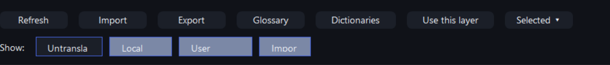

One local 35,014-source diagnostic reduced 60 imported-layer lookups from about **1,280 ms to 16 ms**, and warm comparison preparation from **768 ms to 68 ms**. The measured coverage/comparison/window preparation phases together dropped from about **4.49 s to 2.91 s**. These are fixture timings on one PC, not a promise of that startup time on every system.

The shared in-game renderer, dictionaries, models, saves and game paths are unchanged. All 16 origin combinations, actual popup clicks/cancel/export, source-bound edit saves, cache invalidation and scaled native layouts receive focused checks. Physical multi-monitor DPI changes and full gameplay are outside this UI repair. [Cause, checks and limits](docs/editor-repair-1.0.44.md).

## 1.0.43 — Glossaries, shared dictionaries and three-column comparison
**Local TL → Translations** now compares **native source | current curated English | target text**. Browse model output, authored corrections, selected imports or an individual dictionary. **Use this layer** explicitly chooses the game's layer; browsing or filtering does not change it.

- Independently select **Untranslated**, **Local model**, **User corrected** and **Imported** filters in any combination, together with search. A row with more than one retained layer matches either selected origin. Ctrl/Shift selects multiple rows; the Selected menu queues, regenerates, defers, leaves original or clears authored overrides. Selected identities survive filtering; the count includes hidden rows, and Clear selection clears those too. Unsaved edits remain bound to their original source.
- **Glossary** supplies editable RPG/adult-RPG context presets and a French Celesphonia terminology starter set, including `媚药 → aphrodisiaque`. Matching terms and the optional current English meaning reference go through PLaMo's native glossary/context interface. Save a profile for future requests, or choose **Refresh affected model text** to update relevant cached output. Existing manual/imported text wins and unrelated completed work stays cached. Guidance improves consistency; it does not establish reviewed French for the whole game.
- **Import / Export** share data-only dictionaries. Native packs include family, origin version, language, exact source, role and provenance, optionally a glossary. Source→target JSON/MTool maps, prior local JSONL and bounded ZIP packs are auto-detected. Preview binding, differing targets, invalid controls and inactive entries before importing. User overrides retain precedence. Source-only templates do not replace translations.
- Compatible later installations reuse exact source/role content within the same game family and language. Changed or ambiguous source/roles stay inactive for review. Uncovered imported text is retained and can become usable when a later curated-English update covers that exact source. Derived aliases and display fields are rebuilt with the current Celesphonia adapters; imported scripts or frozen adapter Fields are never installed. Models, user packs and authored work remain separate from curated English and saves.
- Effective order is **user correction → enabled imported dictionaries → model → original**. Dictionaries can be disabled without deleting them. Local caches work without model weights installed. Model processing and the game's selected translation remain separate; resume retains pending progress. UTF-8 BOM framing in JSONL is accepted, while malformed records still report errors.

Before: the reported two-column editor. After: three columns, independent origin filters, layer comparison, glossary and sharing controls. The before image was supplied with the report; the after image is a native launcher capture.

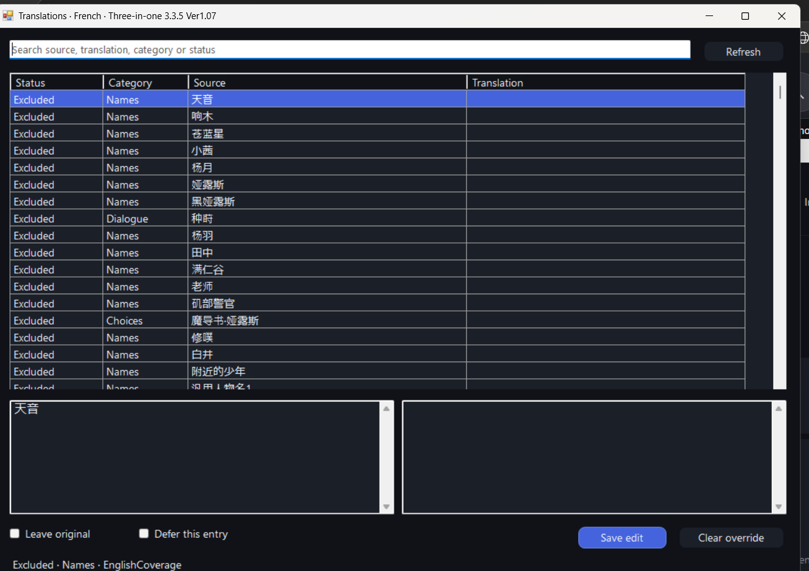

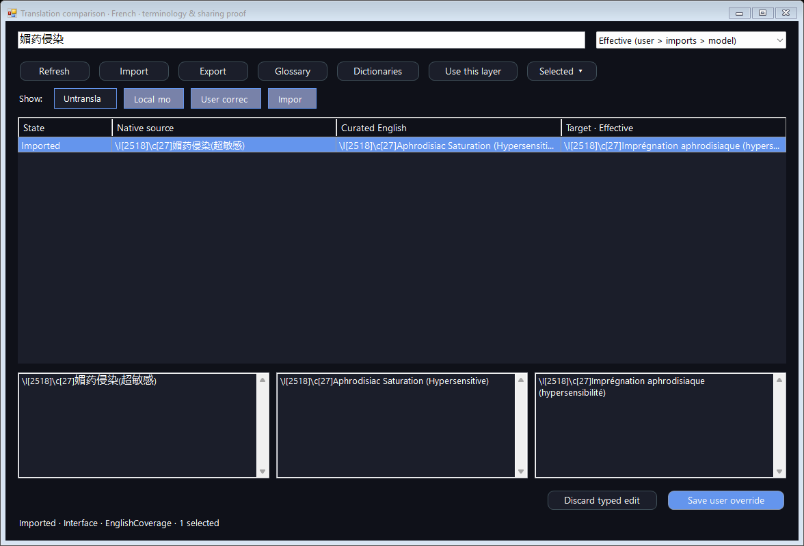

Actual 0.8B sample for the reported label: **Infection par sérocuteur (ultra-sensible)** → **Infection par aphrodisiaque (hypersensible)**. The 2B sample also used *aphrodisiaque*. Both preserved the original icon/color slots. This is a targeted terminology check, not a full language review.

[Format, compatibility rules, checks and limits](docs/local-dictionary-sharing-1.0.43.md). Restart the game after updating to load the current shared provider. Existing dictionaries and successful journals are retained.

## 1.0.42 — Local dictionaries use the established Celesphonia adapters

Fixes the local-translation regression that could turn DTextPicture's engine color `black` into French `noir` and crash the game. Local mode now uses the **same renderer, custom adapters and dictionary preparation as curated English**. PLaMo only supplies a separate dictionary; it no longer scans arbitrary native JSON/plugin strings or automatically enrolls unknown live text.

**Coverage is deliberately restricted to source strings already translated by our English overlay.** The model can translate those covered strings into the selected language; everything outside that set remains original. Technical argument parsing returns native colors, paths, identifiers and control values. Completed entries from old runs are retained; out-of-coverage entries become inactive and remain inspectable in the translation browser. Existing saves and dictionaries are preserved.

- **Resume pending** continues the saved queue. **Retry failures** is separate and optional. Deferred/failed entries are retained; already completed entries are not translated again. Settings can add/remove covered categories and re-enable cached work without starting a new run.
- **Settings** selects CPU, Vulkan GPU or hybrid GPU layers plus CPU remainder, with device, layer and thread controls. Set up the optional GPU backend there without redownloading model weights. The active run shows its backend, processed counts, percentage, speed and estimated time remaining.
- **Translations** opens a separate searchable virtual grid with full source/target text, state and context. Save manual edits, leave an entry original, defer it, clear an override or refresh model results. User overrides take precedence and survive resume. Invalid control/number changes are rejected; inactive legacy rows cannot expand coverage.
- Bounded retries and atomic snapshots address `run.json` sharing conflicts. Status refresh reports persistent I/O errors without throwing an unhandled UI-timer exception.

Before: the old local path, reproduced with a copy of the existing French cache and save. The same session reproduced `addColorStop('noir')`; it is caught by the fixture to capture the menu below.

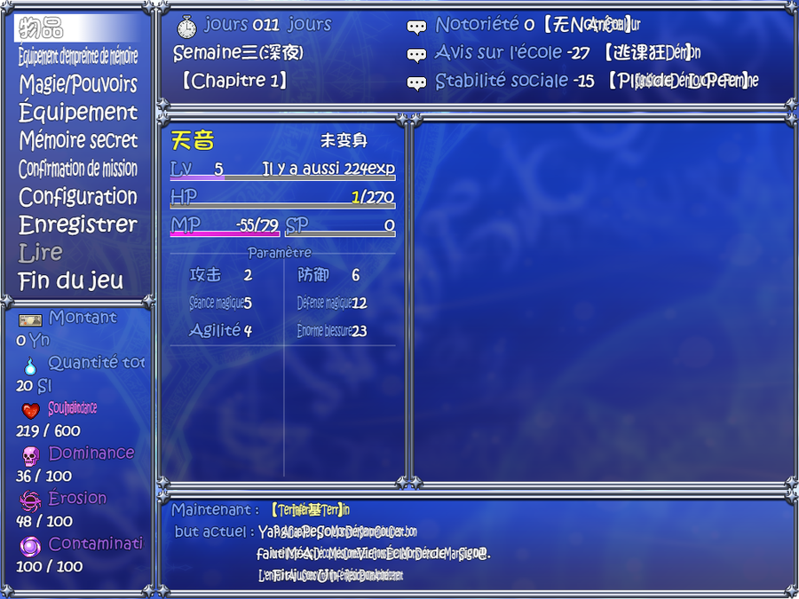

After: the same saved state and partial dictionary through the shared adapters. Uncached/out-of-scope material deliberately stays original; this does not claim complete French translation or reviewed model terminology. Native pictures are resized for these notes; full captures are retained with the trace.

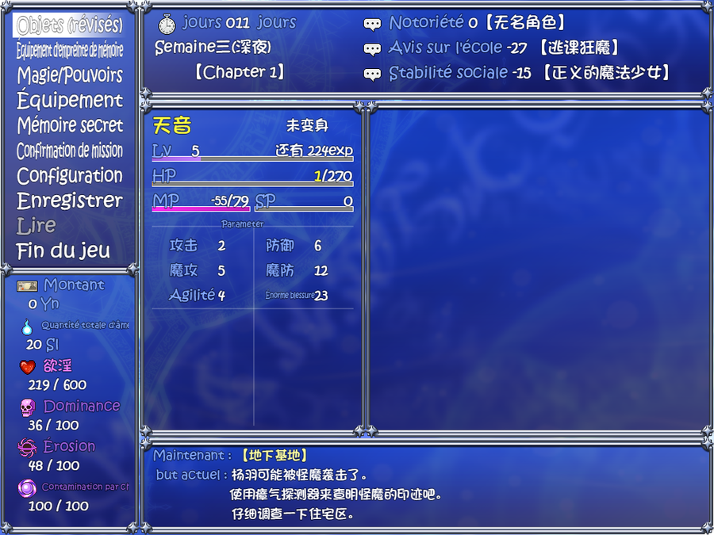

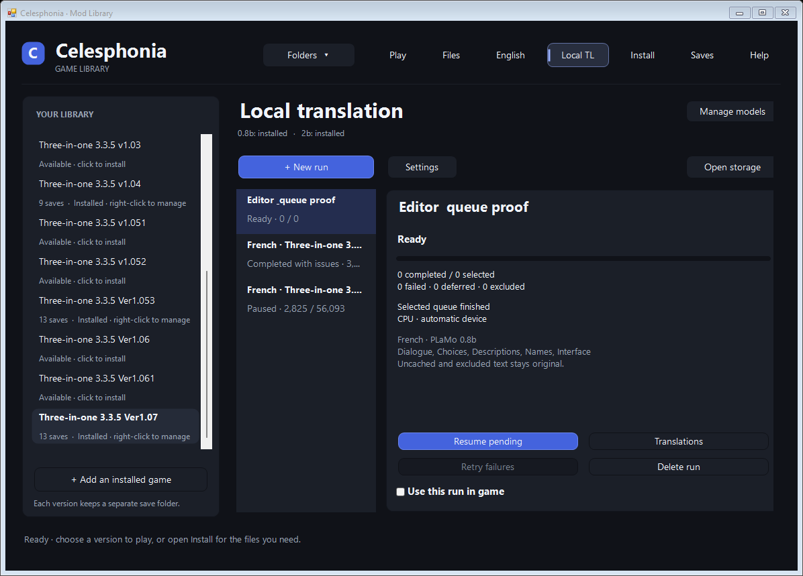

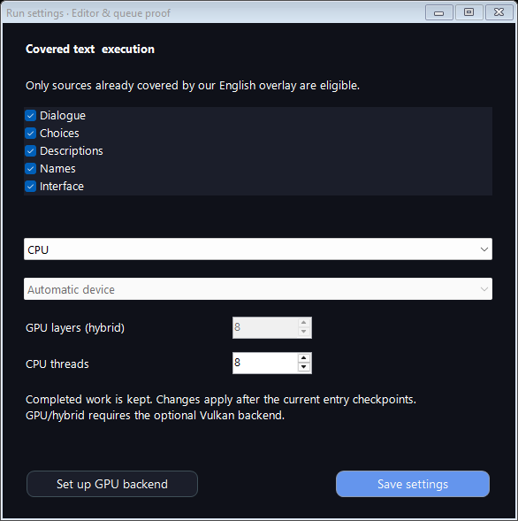

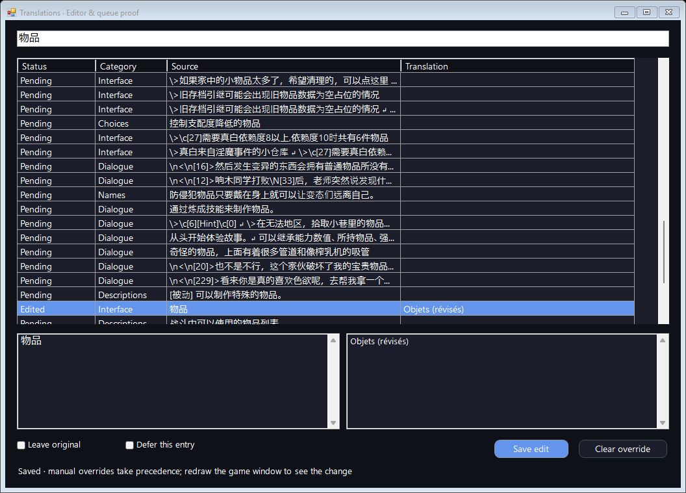

**Focused verification:** the reported color failure was reproduced before repair and resolved with local translation active. Three-in-One 1.07 and Maple native sessions passed the parser/shared-renderer/manual-override checks. Actual CPU, RTX 4070 Vulkan GPU and hybrid inference preserved the test HP value. The existing 3,007-entry journal was retained byte-for-byte in migration. Queue, lock-contention, editor and scope-retention checks accompany the release. Full gameplay, every target language/font, other GPU hardware and every historical adapter screen were not rerun.

[Architecture, migration and verification trace](docs/local-translation-repair-1.0.42.md).

## 1.0.41 — Optional local PLaMo translation

**Local TL** is a separate workspace for automatic translation. Install PLaMo 3 Translate **0.8B** (573 MB) or **2B** (1.81 GB), choose a target language and create named runs for any installed supported game. Matching curated English packs and manual review are not required. Model downloads are optional and are not bundled in the launcher ZIP.

- Choose dialogue, choices, descriptions, interface text and optional names. Unchecked or uncached text stays original.
- Start, pause, resume/retry, select or delete runs. A partial or paused cache can be used immediately; completed batches are saved as they finish. Details shows coverage, unreadable files, errors and a measured speed estimate.
- **Use this run in game** is independent of processing and the English checkbox. A selected local run takes precedence; the saved English setting is retained. Switching English/local rendering mode takes effect at the next game launch. Local run/language changes are picked up while running; descriptions refresh when cache changes.
- Downloads resume and use pinned SHA-256 checks. CPU is the default; Vulkan is optional. Removing a model pauses its jobs and retains cached translations. Deleting a run detaches it and recycles only its generated data. Closing the launcher pauses its owned jobs.
- The existing Celesphonia adapters provide display-only integration, including Maple data decoding, native choices and readable wrapping/scrolling for long help text. Original databases, conditions, formulas and saves remain unchanged. Text embedded in images is outside this feature.

Before: the launcher offered the curated English workspace.

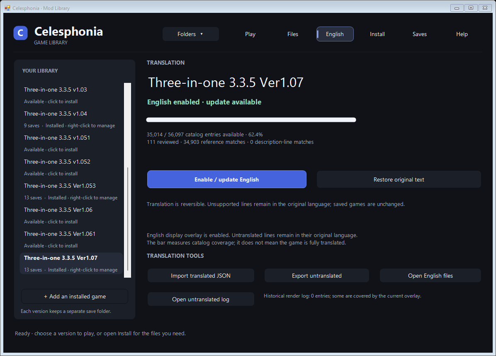

After: independent local runs, progress and display selection. This is a real paused two-entry French proof run, not a fully translated game.

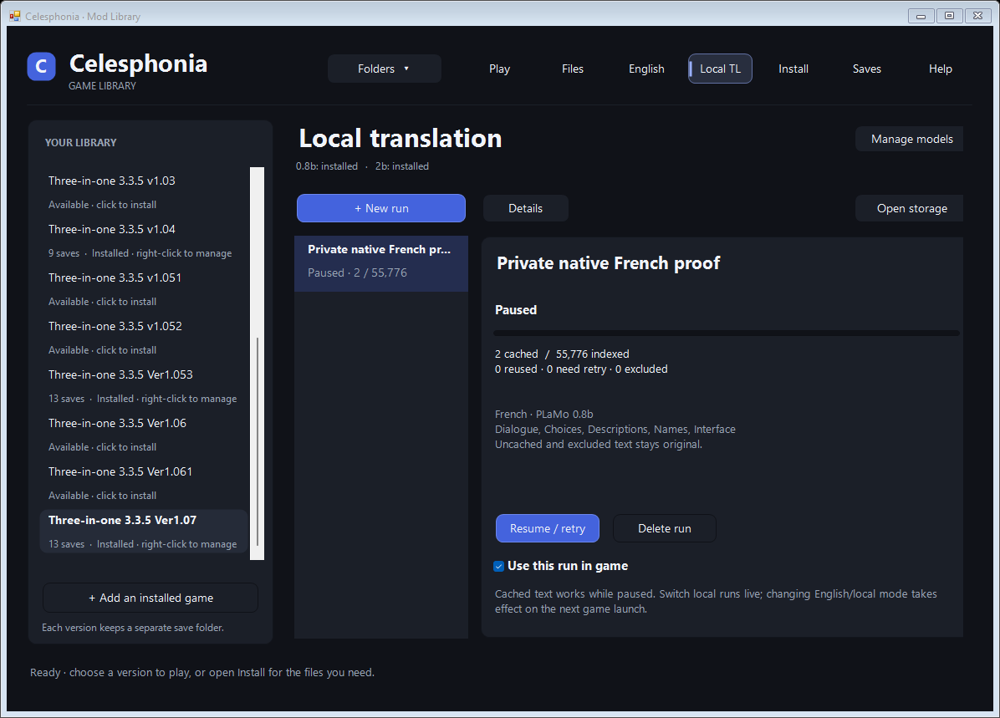

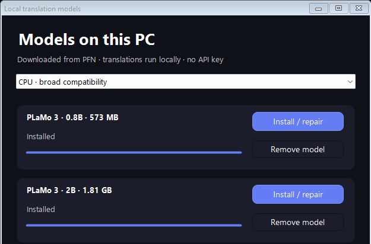

Native French cache displayed with runtime controls off. This sample is raw model output; terminology/fluency may need improvement. The arrow makes the remainder of dense descriptions reachable.

**Verification:** both model sizes completed real English/French inference; pause/resume/reuse/delete and real model removal/cache retention passed. Latest Three-in-One 1.07 and Maple 1.7.2 passed native partial-cache, unchanged-database, wrapping/scroll and English/local coexistence checks. The launcher was opened at 1180×820 and 960×640, including the model manager. CPU inference was tested. Vulkan, every language, every font/RTL case, all DPI settings and full-game translation quality were not verified. The interface offers the model's 53 target languages; that is not a quality guarantee.

[Setup, architecture, source pins and verification trace](docs/local-translation-1.0.41.md). Existing creator notes remain chronological and separate.

## 1.0.40 — Three-in-One Ver1.07

- Adds content-hash detection and the complete 1.07 target: **5,165 creator-overlay files / 11,732 native files**. Install directly from **GoRPG 1.23 + the 1.07 creator bundle**, or combine original archives, extracted folders and individual exact files. Misleading archive extensions remain supported; intermediate versions are not required.
- Carries backed-up saves forward from all ten supported earlier Three-in-One 3.3.5 releases, including the trial. CH, Maple and 3.3.4 remain separate save families; their exact shared files can still contribute to reconstruction.
- Translates all **56 newly indexed display fields** and two derived scar-choice captions. Includes revised potions/talismans, Miasma Adaptation, Abyssphonia damage warnings, slime resistance help, the club changing point and gamepad mode labels. Existing English remains partial.
- Adds the creator's 1.07 notes and official change **208** in chronological order. Retains existing streaming, skill-tooltip, Memory Library and bedroom-display fixes. English works without runtime controls.
- Stores byte-identical embedded pack files once while retaining every logical SHA-256 check and complete public pack. This keeps the executable within older launchers' update size limit; no game files are merged or deduplicated.

### Vitality Potion I

Before:

After:

### Power Sigil I

Before:

After:

### Miasma Adaptation

Before:

After:

### Storm Pierce

Before:

After:

[Native before/after pictures, source delta and verification limits](https://github.com/kitomisaitichi-design/celesphonia-launcher/blob/launcher-v1.0.40/docs/v107-1.0.40-trace.md).

## 1.0.39 — Translate Memory Library prerequisite names

**Before:** Lightning Magic III displayed its prerequisite as **电击魔法Ⅱ restored**, despite the tier-II name already having an English dictionary entry. The name was expanded after the surrounding sentence had translated.

**After:** the same native row displays **Lightning Magic II restored**. The shared icon/name helper now translates the resolved display name for item, weapon, armor, skill and state references, including variable-derived IDs. Stored names, IDs, icons, costs, required levels, repair progress and eligibility checks remain unchanged.

Native checks cover both full prerequisite catalogs: **46 Three-in-One records and 47 Maple records**, including **92 prior-engram rows**, both availability colors and level/repair/cost fields. **4,575 named icon references** are checked, with existing item-reference output preserved. Runtime controls are not required.

[View matching before/after pictures for both variants](https://github.com/kitomisaitichi-design/celesphonia-launcher/blob/launcher-v1.0.39/docs/memory-library-1.0.39-trace.md). Enabled English overlays refresh normally. This corrects event-picture prerequisite text; the previous skill-tooltip census covered a different renderer.

## 1.0.38 — Translate skill effect names before assembling the tooltip

**Before:** Force Barrier II showed Chinese DEF/MDF buff names and an internal instant-skill event name even though its main description was English. The earlier fix checked six skills per variant; its 85 assertions were not a full skill census.

**After:** native referenced names are localized before color formatting, percentages and layout. This also covers other skills using the same state, removal, passive, learned-skill and special-effect fields. Formulas, costs, effect chances, spell names and native identifiers remain exact. Maple's native Resistance Up effect remains distinct from Three-in-One's MDF Boost.

The native generator now visits all **1,300 Three-in-One** and **1,500 Maple** records, including **1,874 named skills**, with no unexplained CJK text in the generated detail fields. Blank/reserved records are counted separately. This is display-field coverage, not a full gameplay replay or a claim that every game text is translated.

### Three-in-One — native buff-name crop

Before:

After:

### Maple — native buff-name crop

Before:

After:

[Full native tooltip comparisons, coverage and limits](https://github.com/kitomisaitichi-design/celesphonia-launcher/blob/launcher-v1.0.38/docs/skill-fields-1.0.38-trace.md). Enabled English overlays refresh normally; runtime controls are not required. Bundled notes are losslessly compressed to retain the unchanged updater size limit and offline before/after images.

## 1.0.37 — Read split ZIP volumes correctly

**Before:** a valid `.zip.001` plus `.002` could fail with **End of Central Directory record could not be found** because ZIP header detection selected the single-file reader. **After:** first volumes use the existing volume-capable reader; the verified sample restores all 6,000 bytes exactly. No new archive dependency is required.

Keep every volume together with its original matching name, then select the first `.001`. The continuation `.002` is read automatically; do not extract it separately. Incomplete, corrupt, unsafe or duplicate entries still fail, and final game-file sizes/hashes remain required. Ordinary/mislabelled ZIPs, split 7z, RAR and individual native fragments remain supported.

Grenim's reported 4,455 missing files include creator-mod media. Their exact archive format is unconfirmed: this fixes a reproduced split-ZIP defect, not every missing-source report. An incomplete extracted folder still needs the complete original volumes. Existing games, saves and English overlays are unchanged. [Diagnostic trace](https://github.com/kitomisaitichi-design/celesphonia-launcher/blob/launcher-v1.0.37/docs/split-archive-1.0.37-trace.md).

## 1.0.36 — Cover the manual creator-archive picker too

Completes the Map027 upgrade recovery below when the creator bundle is first selected manually after the initial source scan. The chosen archive receives fresh exact-target checks before the older source audit can block recovery, including a download replaced under the same filename. Full target verification, compatible save backup/copy, strict source checks when conversion needs them, and original-file preservation remain unchanged.

**Before:** a manually picked bundle could still fall through to the old-source Map027 error. **After:** a complete exact target is reconstructed through the same verified path as discovered originals. [Diagnostic trace and limits](https://github.com/kitomisaitichi-design/celesphonia-launcher/blob/launcher-v1.0.36/docs/map027-upgrade-1.0.35-trace.md).

## 1.0.35 — Recover upgrades blocked by an older source map

Fixes both source-method choices getting stuck on **Source creator file changed or missing: data/Map027.json** in an older installed game, even when the original inputs already supply every correct file for Ver1.061.

**Before:** the creator-bundle path verified the complete new target, then rejected the older game again while carrying its saves. Conversion auto-selection could stop at the same old-source error before reaching a valid original-file reconstruction.

**After:** when every final target file passes the authoritative native inventory, either source method can build that independent target and carry backed-up, compatible saves. The old game's native tree is not blindly copied or marked intact. Each selected input file is still rechecked during recovery. Without complete originals, conversions retain their existing strict source checks; missing target bytes, unknown versions, cross-branch saves and downgrades remain rejected.

The source game/map and saves stay untouched. Normal saves, optional runtime-control progress and custom control preferences keep their existing verified migration behavior. No translation dictionary, game mechanic or native-map edit is part of this update.

Verified against the reproduced shared older-game failure, a full **11,738-file** Ver1.061 reconstruction and focused branch/running-game/destination checks. The private source fixture is Ver1.053, which shares the reported Ver1.052 guard and Map027 hash; this is not an exact replay of the reporter's files. [Before/after diagnostic evidence and limits](https://github.com/kitomisaitichi-design/celesphonia-launcher/blob/launcher-v1.0.35/docs/map027-upgrade-1.0.35-trace.md).

## 1.0.34 — Readable magic-skill tooltip details

- Translates the lower skill-tooltip labels and element fragments in Three-in-One Ver1.061 and Maple 1.7.2. Ice is now shown as **HP Damage / Ice**, the formula caption is English, and **Usable: In Battle** replaces **Usable:Fight**. Labels and values have readable spacing.
- Keeps native damage formulas, targets, percentages, MP costs, spell names and variant-specific effects exact. For example, Gefrier retains Three-in-One's 40% freeze chance and Maple's 20% chance. The existing German-style spell names are intentional and remain.
- Measures translated tooltip text before sizing the panel. Oversized skill details wrap at their native readable font size and retain the full text with hover-wheel scrolling. Ordinary state/equipment tooltips retain their previous behavior.
- Fixes Maple displaying **Additional Cost: undefined** when an ordinary skill has no optional custom-cost field. Real custom costs and native visibility settings are respected.
- Works with English enabled and runtime controls off. Existing enabled English overlays refresh through the normal launcher path; no manual remove/reapply is needed.

**Before — native formula caption**

**After — English formula caption**

These are native text-layer detail crops at the original font size. [Full native Three-in-One and Maple before/after screenshots](https://github.com/kitomisaitichi-design/celesphonia-launcher/blob/launcher-v1.0.34/docs/skill-tooltip-1.0.34-gallery.md) · [Source trace and verification limits](https://github.com/kitomisaitichi-design/celesphonia-launcher/blob/launcher-v1.0.34/docs/skill-tooltip-1.0.34-trace.md)

## 1.0.33 — Readable enemy stats, states and traits

- Gives stat labels and values separate space in Three-in-One's battle inspector, fixing overlapping evasion, reflection, attack-speed and recovery captions. Native HP, MP, percentages and other values stay exact.
- Wraps long state names and puts permanent/remaining-turn captions on a separate row. Dense state lists retain native selection and scrolling.
- Fits resistance/trait tables inside the screen. Conventional abbreviations are used when required, and the table uses fewer columns when needed. Long tables keep their full content: hover the table and use the mouse wheel; native arrows indicate more rows. The list underneath keeps its selection while you scroll the table.
- Runs with the ordinary English overlay; runtime controls are not required. The adapter checks the native plugin's actual capabilities. Maple's different tooltip has been checked and keeps its existing behavior.

**Before — overlapping stat values and state captions**

**After — aligned values and separate duration rows**

[Full native trait-table before/after gallery](https://github.com/kitomisaitichi-design/celesphonia-launcher/blob/launcher-v1.0.33/docs/enemy-info-1.0.33-gallery.md) · [Source trace and verification limits](https://github.com/kitomisaitichi-design/celesphonia-launcher/blob/launcher-v1.0.33/docs/enemy-info-1.0.33-trace.md)

## 1.0.32 — Preserve imported translations during automatic refresh

Fixes automatic English refresh reporting failure after a bundled dictionary update when a user has additional imported translations. The overlay was applied successfully, but stale cached counts made it appear outdated again and could block launch. Refresh now rebuilds only those derived counters from the validated merged dictionary. Custom translation files, native data and saves stay unchanged. Includes all 1.0.31 imprint fixes and the native before/after gallery below.

## 1.0.31 — Readable English imprint descriptions

- Fixes the imprint menu splitting original descriptions into fragments before translation. Complete reviewed skill descriptions now translate first, then wrap at word boundaries. This resolves mixed Chinese/English in Cyclone Break, Burst Impact, Mental Focus and the related imprint skill panels in Three-in-One and Maple.
- Fits long skill titles inside the existing panel and retains native skill colors. Full wording remains when it fits; overflowing panels use conventional stat abbreviations. Very long imprints retain their text in a readable scrolling panel: hover the description and use the mouse wheel. Native arrows show when more text is available.
- Corrects four source-exact inherited percentage fields: ATK +10%, ATK +15%, Max HP +10% and Max HP +15%. The English numbers now match each native source field across all 13 compatible packs. Native effects, formulas, IDs and values are unchanged. Other game/version differences remain intact, including Maple's three-hit skill versus the newer Three-in-One two-hit skill.
- Native checks cover all 80 Three-in-One Ver1.061 and 82 Maple imprints, selection/empty/reset behavior and dense-panel scrolling, with runtime controls disabled. Original data and private test state remain unchanged by rendering. This remains a partial English overlay; no full gameplay sweep is claimed.

### Three-in-One Ver1.061 — before and after

These native description-panel captures use the same private four-slot loadout, selection and panel size. They retain the native text pixels and font size. Before: Chinese fragments and clipped English. After: whole descriptions and complete titles fit the panel.

### Maple 1.7.2 — before and after

The same display correction follows Maple's own source wording and effects, preserving its skill differences.

Update the launcher and launch with your enabled English overlay. It refreshes automatically; runtime controls are not required. See the [source and verification trace](docs/imprint-1.0.31-trace.md).

## 1.0.30 — Fix original-source destination conflicts

- Fixes the default install location when the portable launcher sits inside GoRPG or another original source folder. A new independent game is placed outside all selected source folders, instead of failing after a successful source audit.
- Repairs older saved automatic defaults too. Valid custom destinations remain unchanged; unsafe custom locations open a validated folder picker with folder creation. Cancelling preserves the previous settings and starts no installation.
- Shares the destination check across direct/combined-original installation, creator upgrades, layered mods and reconstruction. Checks run before creating the new destination/staging parent. Native source containment and exact hashes remain enforced.
- Keeps existing installed game roots, saves, control sessions, selected profiles and translation behavior intact. This is an installation-location fix; it does not add a speed optimization or relax source verification.
- Restores the user's corrected magic-defense abbreviation **MDF**. Compact equipment stats use **ATK, DEF, MAT, MDF and AGI**; the prior MD substitution is removed. Dictionary wording, native values and gameplay mechanics are unchanged.
- Fixes the stale Ver1.053 label in the launcher-update dialog. Its supported game-release name now comes from the same catalog as installation and upgrades, currently **Ver1.061**, and follows future supported releases automatically.

### Before and after — launcher extracted inside an original game

The native Install-page previews below use the same isolated folder layout and source selection. Before: the default sits inside Original GoRPG/Launcher/Game Profiles. After: Celesphonia Game Profiles sits outside the source tree. A minimal exact-byte reconstruction separately reproduces the old failure and succeeds at the corrected location; these previews do not claim a full-game install.

### Restored MDF abbreviation

The following native captures compare 1.0.29's MD labels with the exact restored MDF runtime from 1.0.28. Its bytes and unchanged dictionaries match the prior native Maple/Ver1.061 checks; no new gameplay pass is claimed.

If an earlier attempt displayed this specific error, update the launcher and retry with the same original files. You do not need to remove the English overlay or download those files again. For custom destinations, choose or create a folder outside every selected original source folder. See the [source and verification trace](docs/destination-1.0.30-trace.md).

## 1.0.29 — Match Kagura and CH56.6 stat abbreviations

Uses **ATK, DEF, MAT, MD and AGI** when compacting equipment descriptions. Magic defense and its compact stat-down effects now use **MD**, retaining the familiar Kagura/CH56.6 terminology. This changes display labels only; original stat IDs, modifiers, signs and numeric values are unchanged.

Retains all 1.0.28 equipment fixes for Maple and Three-in-One: overflow-aware abbreviations, English composed AGI-down labels, complete wrapped descriptions, readable scrolling help with native arrows, and wheel routing that leaves the item list alone. Already-fitting descriptions keep their full wording. Optional controls are not required. The full overflow before/after gallery follows in the 1.0.28 section below.

The following pair shows the same native Demon King Core panel, at the same scroll position: 1.0.28's MDF labels become MD in 1.0.29. Other effects and values stay intact.

Native equipment rendering and interaction checks were rerun in Maple 1.7.2 and Three-in-One Ver1.061 with the corrected runtime, including all 854 named weapon/armor records. This remains a partial English display overlay; full gameplay routes were not replayed. See the [updated trace](docs/equipment-help-1.0.28-trace.md).

## 1.0.28 — Readable equipment descriptions and English trait labels

- Fits the complete weapon/armor description together, including the formatter's appended stats and traits. Fixes long English lines clipping in Maple 1.7.2 and Three-in-One Ver1.061.
- Uses familiar abbreviations only when full wording does not fit: ATK, DEF, AGI, PHYS-EVA, CRIT-EVA, MAG-EVA, MAT, MDF and related labels. Full wording stays when it fits. Native values, signs, percentages, conditions, icons and control slots remain intact.
- Reuses reviewed whole state labels inside assembled brackets. The reported 敏捷下降（小） / 敏捷下降（大） fields now render English, compacted to AGI Down (S) / AGI Down (L) when needed. S/L retain the distinction between the two native effects.
- Keeps dense equipment help readable at 20px or larger. Hover the help panel and use the mouse wheel to reach the rest; native arrows indicate more text. The equipment list does not scroll while the pointer is over scrollable help.
- Runs as part of the English display overlay with optional controls off. No game-data, save-path, install/upgrade or stat-mechanic changes. Existing enabled English overlays refresh on the next Play as before.

### Three-in-One Ver1.061 — Ninja Hood

Before: the stat/trait line extends beyond the help panel. After: familiar abbreviations expose the English AGI effects; the remaining line is reachable by scrolling.

### Maple 1.7.2 — Ninja Hood

The same source record in Maple's wider native panel now fits with English AGI traits and compact stats. Window dimensions are unchanged between each pair.

### Weapon descriptions — Master Blade

Before: the long generated effect list is cut off. After: the complete description is wrapped and readable; scroll to inspect later effects.

### Dense descriptions — Demon King Core

Before: even tiny text clips vertically. After: readable text with compact trait labels, with the remaining effects accessible below. The last image shows the bottom of the same help panel after scrolling.

Native rendering checks cover all 854 named weapon/armor records across Maple and Ver1.061, plus wheel routing, empty/repeated selection, refresh, numeric/control-code preservation and unchanged native databases. These are isolated native UI checks, not a full gameplay walkthrough or a claim of complete English coverage. See the [source and validation trace](docs/equipment-help-1.0.28-trace.md).

## 1.0.27 — Carry legacy runtime sessions after profile rediscovery

Retains the Ver1.06/1.061 support and all 24 new translations from 1.0.26. When shared discovery assigned a new profile ID, an older control session can still hold the same game's independent saves and panel settings. Upgrades now locate a unique matching session by its original save path, back it up and carry it independently. Ambiguous matches remain untouched and stop with an explicit message.

## 1.0.26 — Ver1.06 / Ver1.061 originals, upgrades and English

- Registers both complete creator content overlays and their full native target inventories: 5,171 overlay files / 11,738 target files per version. The latest forward-upgrade target is Ver1.061.
- Direct GoRPG plus latest content installation needs no intermediate patch. The existing exact-hash pool accepts archives, misleading extensions, recursive extracted trees, partial sources and individual files. Compatible shared bytes from other bases remain usable.
- Adds strong native fingerprints, including CommonEvents and Map002, so 1.06 and 1.061 are distinguished even though their System.json is identical. The newer archive's misleading 1.062 folder name does not override its verified 1.061 identity.
- Forward Three-in-One 3.3.5 routes preserve backup/old-profile boundaries and carry save files, global/config metadata and the runtime-control checkbox. Reverse or unrelated-branch automatic save transfers remain rejected.
- Translates all 24 newly introduced display strings in both new partial-English packs, preserving formatting/control codes and existing reviewed translations. Shared native artwork hashes are verified before retaining the illustrated fixes; unchanged bedroom data retains its previous display repair.
- Adds the creator's Ver1.06 and Ver1.061 announcements in chronological order. Existing notification names, blank-field, memory-grid, streaming, HDR and updater repairs remain.

See the [version/source trace](docs/v106-support-trace.md). Original native files and gameplay conditions remain unchanged by the English display overlay. Full gameplay compatibility is not implied by native/hash checks.

## 1.0.25 — Remaining notification names and anal terminology

- Fixes the remaining native notification paths, including **Heart (2980)** and **Noicon (2950)**. The previous name repair only handled Talk (2944) and the separate time field.
- The nested message value is resolved during native drawing across the supported TMng modes and alternate notification frames. Amane, Celesphonia and custom names remain visible; a name-only field no longer becomes empty when the renderer consumes its name as an escape code.
- Native notification arguments, stored values, intentional line breaks and event logic are preserved. This does not remove all blank rows indiscriminately or alter user saves. Unknown text remains native.
- **Extreme Sensitivity (Anal)** replaces **Extreme Sensitivity (Intestines)**. Its description now says **Anal development EXP modifier**. Skill 955's tags map to the anal-development cap and EXP stats; no mechanical value changes.
- Works without runtime controls. Play refreshes an already-enabled English overlay after the launcher update. Memory-grid fixes, save paths, HDR options, controls and updater safeguards remain.

### Additional notification path — before and after

### A name-only field — before and after

### Title terminology — before and after

Notification images use neutral test messages with the reproduced native escape structure and the actual native ticker renderer; they are not replacement game dialogue. The title examples use native skill 955. Comparisons use identical temporary state, never player saves. See the [source trace](docs/notification-1.0.25-trace.md). Full gameplay coverage is not claimed.

## 1.0.24 — Actor names and memory descriptions

- Nested English notifications retain Amane/Celesphonia and custom actor names. The display hook resolves the native name escape before the ticker inserts the message; it does not rename game actors.
- Empty locked-memory descriptions remain blank rather than becoming numeric zero. Maple's native question-mark placeholder is preserved.
- Long memory titles fit the available column width while retaining each variant's native row spacing (24 px in Ver1.053, 29 px in Maple). The last columns no longer drift away from their selection cursor.
- Selecting an unused cell in the final column uses the native locked-description sentinel for that display read, instead of treating an unrelated profile variable as a skill ID. Stored profile values and unlock prerequisites remain intact.
- Normal English launches receive these fixes with runtime controls disabled. After updating, use Play to refresh an already-enabled overlay automatically. Existing save paths, HDR options, controls and updater safeguards are retained.

### Missing actor name — before and after

### Locked description — before and after

### Ver1.053 memory grid — same selection, before and after

### Maple memory grid — same selection, before and after

These comparisons show actual native ticker/picture layers on a plain backdrop, with identical temporary test state before and after. They do not use or modify player saves. Native checks cover locked/unlocked entries, the last columns, unused tail cells and renamed actors; full gameplay coverage is not claimed.

## 1.0.23 — HDR compatibility and clearer runtime controls

- Root package.json launch preferences such as chromium-args are accepted in normal and control-session launches. The selected native entry remains verified; deep installation/source hash checks stay exact.
- Live HP/MP bars show the active party leader's current/maximum values across tabs, with clear empty/no-character states.
- Rounded controls, smooth hover highlights and a more compact navigation strip retain themes, opacity, resizing and header-only dragging.
- Click the shortcut in the header to change it. Ctrl+Shift+G replaces F8 as the default to avoid laptop airplane-mode keys; the Controls button remains available. The saved shortcut also works detached.
- Game data, translations, save paths and 1.0.22 updater safeguards are retained.
- English application retries brief Windows file-lock/remove errors during atomic replacement, with hash guards. Persistent locks or externally changed files still stop with an explicit path; there is no delete/copy fallback.

## 1.0.22 — Changed-file updates and explicit rollback results

- Identical installed assets are no longer replaced or copied to rollback. A two-file update no longer rewrites all 38 packaged files.
- Launches the checksum-verified staged launcher for the existing update command, removing the extra random helper EXE copy.
- Full ZIP/payload checks, path restrictions, parent-exit wait and backups remain. Rollback restores only completed replacements and reports failures explicitly.
- Investigated after a Bitdefender Advanced Threat Defense behavior report. The redundant writes are reproduced and corrected; Bitdefender validation remains pending.
- Affected 1.0.19–1.0.21 users need the README's one-time three-file ZIP transition because their installed updater still runs during its first upgrade. Antivirus settings and quarantine are not changed.

All 1.0.21 game-display fixes, illustrations and chronological developer notes are retained. Game JavaScript and English packs are unchanged in this release.

## 1.0.21 — Readable status panels and illustrated notes

- Maple and Three-in-One: resistance labels and values have separate bounded cells, compact names and aligned values. Clothing HP fits both percentage and current/maximum displays.
- Native numbers, signs, colors, picture text and game logic remain intact. These presentation fixes work with optional F8 controls disabled.
- Help opens a themed, resizable notes reader with section navigation, offline images and separate launcher/developer histories. README is a concise starting guide.

### Maple — same values, before and after

### Three-in-One Ver1.053 — same values, before and after

These images show the actual native CE806 picture renderer with controlled in-memory values. Source game records and saves are not edited for the comparison.

## 1.0.20 — Automatic English refresh on Play

Normal and F8 launches refresh outdated, already-enabled English overlays before starting. Recipients no longer need to remove/reapply English after updating. Current overlays are a no-op; disabled overlays remain disabled. Direct game-executable launches bypass launcher checks.

## 1.0.19 — Repeat streaming without runtime controls

The narrow stale-message-pause repair is included in the regular English overlay. F8 controls are optional. Native first-stream and repeat-stream conditions remain in effect, and duplicate repair loading is harmless.

## 1.0.18 — Repeat-stream choice handoff

Repairs the stale message pause left by the bedroom PC menu when the repeat-stream prompt is queued. The initial release applied this through Control Sessions; 1.0.19 extended it to normal English launches.

## 1.0.17 — Time-of-day display

Resolves the time name in the native notification's display path so translated time labels are not swallowed as escape codes. Stored actor/variable names remain original.

## 1.0.16 — Direct Ver1.053 installation

Install creator Ver1.053 from Gorpg plus matching creator content without Ver1.051 or Ver1.052. Recursive discovery combines original files from ZIP/RAR/7z, renamed archives, extracted folders and partial sources using verified hashes. The separate partial English pack retains reviewed labels and adds four changed display strings.

## 1.0.15 — Clean CH reference

Uses clean native CH hashes for source compatibility; English-patched metadata does not become the canonical native reference. Source profiles and saves stay separate.

## 1.0.14 — Library navigation

Improved compact launcher navigation, visible runtime-control selection and theme consistency. Main Play controls remain directly accessible.

## 1.0.13 — Original-file interoperability

Finds matching native bytes across supported sources rather than requiring a specific intermediate version or archive name. Unknown and missing files are reported before managed installation.

## 1.0.12 — Fresh creator installation

Added direct installation from a clean base and complete creator overlay while retaining forward upgrades and source-save safeguards.

## 1.0.11 — Glossary illustration layout

Measures wrapped English text before positioning illustrations. Images preserve aspect ratio and fit the remaining panel; text-only and image-only entries retain their layouts.

## 1.0.10 — Wardrobe interaction indicators

Renders the complete narrow wardrobe below native indicators so the lower interaction marker blinks again.

## 1.0.9 — Separate bedroom actions

Fits complete wardrobe artwork into its narrow footprint and places the second interaction above it. Preserves native unlock conditions and the transparency/coat menu after native recalculation.

## 1.0.8 — Native wardrobe footprint

Preserves the narrow cabinet footprint and native map data while retaining translated help images, glossary fitting and controls.

## 1.0.7 — English help images and text fitting

Adds reversible translated tutorial/glossary images and hypnosis captions, native ticker translation, and item-help wrapping with icon-width awareness. Assets are embedded to preserve older updater ZIP compatibility.

## 1.0.6 — Creator Ver1.051 / Ver1.052

Adds creator-version detection, verified upgrades and separate partial English packs. Original sources and saves are preserved.

## 1.0.5 — English runtime labels

Restores reviewed display labels omitted from the fresh v1.04 source inventory while excluding changed dialogue and database content.

## 1.0.4 — Backward-compatible update package

Embeds developer notes in the executable instead of adding an unsupported ZIP entry. Older launchers can verify and install the release.

## 1.0.3 — Official update source

Fresh downloads know the official GitHub repository and check for stable releases. Existing opt-out/custom repository settings are retained. Installs verify checksums and keep rollback data.

## 1.0.2 — Window-title translations

Restores v1.04 on-screen title, controls and save-caption translations while preserving internal identification strings.

## 1.0.1 — Existing game profiles

Hides unavailable/incomplete profile entries without deleting records or saves. Independent game folders no longer require a removed historical base for optional runtime asset lookup.
