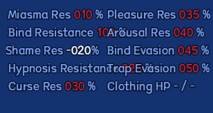
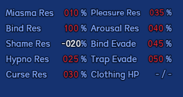
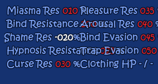
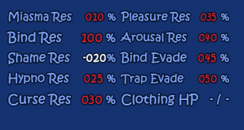

# Launcher updates

Launcher releases change this tool and its reversible display overlays. Game-mod developer announcements are in the separate **Game developer notes** view.

## 1.0.23 — HDR compatibility and clearer runtime controls

- Root package.json launch preferences such as chromium-args are accepted in normal and control-session launches. The selected native entry remains verified; deep installation/source hash checks stay exact.
- Live HP/MP bars show the active party leader's current/maximum values across tabs, with clear empty/no-character states.
- Rounded controls, smooth hover highlights and a more compact navigation strip retain themes, opacity, resizing and header-only dragging.
- Click the shortcut in the header to change it. Ctrl+Shift+G replaces F8 as the default to avoid laptop airplane-mode keys; the Controls button remains available. The saved shortcut also works detached.
- Game data, translations, save paths and 1.0.22 updater safeguards are retained.
- English application retries brief Windows file-lock/remove errors during atomic replacement, with hash guards. Persistent locks or externally changed files still stop with an explicit path; there is no delete/copy fallback.

## 1.0.22 — Changed-file updates and explicit rollback results

- Identical installed assets are no longer replaced or copied to rollback. A two-file update no longer rewrites all 38 packaged files.
- Launches the checksum-verified staged launcher for the existing update command, removing the extra random helper EXE copy.
- Full ZIP/payload checks, path restrictions, parent-exit wait and backups remain. Rollback restores only completed replacements and reports failures explicitly.
- Investigated after a Bitdefender Advanced Threat Defense behavior report. The redundant writes are reproduced and corrected; Bitdefender validation remains pending.
- Affected 1.0.19–1.0.21 users need the README's one-time three-file ZIP transition because their installed updater still runs during its first upgrade. Antivirus settings and quarantine are not changed.

All 1.0.21 game-display fixes, illustrations and chronological developer notes are retained. Game JavaScript and English packs are unchanged in this release.

## 1.0.21 — Readable status panels and illustrated notes

- Maple and Three-in-One: resistance labels and values have separate bounded cells, compact names and aligned values. Clothing HP fits both percentage and current/maximum displays.
- Native numbers, signs, colors, picture text and game logic remain intact. These presentation fixes work with optional F8 controls disabled.
- Help opens a themed, resizable notes reader with section navigation, offline images and separate launcher/developer histories. README is a concise starting guide.

### Maple — same values, before and after

### Three-in-One Ver1.053 — same values, before and after

These images show the actual native CE806 picture renderer with controlled in-memory values. Source game records and saves are not edited for the comparison.

## 1.0.20 — Automatic English refresh on Play

Normal and F8 launches refresh outdated, already-enabled English overlays before starting. Recipients no longer need to remove/reapply English after updating. Current overlays are a no-op; disabled overlays remain disabled. Direct game-executable launches bypass launcher checks.

## 1.0.19 — Repeat streaming without runtime controls

The narrow stale-message-pause repair is included in the regular English overlay. F8 controls are optional. Native first-stream and repeat-stream conditions remain in effect, and duplicate repair loading is harmless.

## 1.0.18 — Repeat-stream choice handoff

Repairs the stale message pause left by the bedroom PC menu when the repeat-stream prompt is queued. The initial release applied this through Control Sessions; 1.0.19 extended it to normal English launches.

## 1.0.17 — Time-of-day display

Resolves the time name in the native notification's display path so translated time labels are not swallowed as escape codes. Stored actor/variable names remain original.

## 1.0.16 — Direct Ver1.053 installation

Install creator Ver1.053 from Gorpg plus matching creator content without Ver1.051 or Ver1.052. Recursive discovery combines original files from ZIP/RAR/7z, renamed archives, extracted folders and partial sources using verified hashes. The separate partial English pack retains reviewed labels and adds four changed display strings.

## 1.0.15 — Clean CH reference

Uses clean native CH hashes for source compatibility; English-patched metadata does not become the canonical native reference. Source profiles and saves stay separate.

## 1.0.14 — Library navigation

Improved compact launcher navigation, visible runtime-control selection and theme consistency. Main Play controls remain directly accessible.

## 1.0.13 — Original-file interoperability

Finds matching native bytes across supported sources rather than requiring a specific intermediate version or archive name. Unknown and missing files are reported before managed installation.

## 1.0.12 — Fresh creator installation

Added direct installation from a clean base and complete creator overlay while retaining forward upgrades and source-save safeguards.

## 1.0.11 — Glossary illustration layout

Measures wrapped English text before positioning illustrations. Images preserve aspect ratio and fit the remaining panel; text-only and image-only entries retain their layouts.

## 1.0.10 — Wardrobe interaction indicators

Renders the complete narrow wardrobe below native indicators so the lower interaction marker blinks again.

## 1.0.9 — Separate bedroom actions

Fits complete wardrobe artwork into its narrow footprint and places the second interaction above it. Preserves native unlock conditions and the transparency/coat menu after native recalculation.

## 1.0.8 — Native wardrobe footprint

Preserves the narrow cabinet footprint and native map data while retaining translated help images, glossary fitting and controls.

## 1.0.7 — English help images and text fitting

Adds reversible translated tutorial/glossary images and hypnosis captions, native ticker translation, and item-help wrapping with icon-width awareness. Assets are embedded to preserve older updater ZIP compatibility.

## 1.0.6 — Creator Ver1.051 / Ver1.052

Adds creator-version detection, verified upgrades and separate partial English packs. Original sources and saves are preserved.

## 1.0.5 — English runtime labels

Restores reviewed display labels omitted from the fresh v1.04 source inventory while excluding changed dialogue and database content.

## 1.0.4 — Backward-compatible update package

Embeds developer notes in the executable instead of adding an unsupported ZIP entry. Older launchers can verify and install the release.

## 1.0.3 — Official update source

Fresh downloads know the official GitHub repository and check for stable releases. Existing opt-out/custom repository settings are retained. Installs verify checksums and keep rollback data.

## 1.0.2 — Window-title translations

Restores v1.04 on-screen title, controls and save-caption translations while preserving internal identification strings.

## 1.0.1 — Existing game profiles

Hides unavailable/incomplete profile entries without deleting records or saves. Independent game folders no longer require a removed historical base for optional runtime asset lookup.
