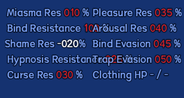
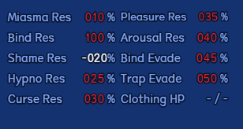
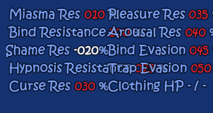
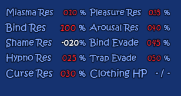

# Celesphonia Mod Library

Portable Windows launcher with verified installation and upgrades, separate game profiles, partial English display overlays and optional runtime controls.

## Launcher 1.0.43 — Glossary, comparison and portable dictionaries
Open **Local TL → Translations** for **Source | curated English | target** comparison, optional glossary/context profiles, and dictionary **Import / Export**. Combine **Untranslated / Local model / User corrected / Imported** filters with search. Ctrl/Shift selects rows for bulk actions; browsing a layer does not change the game's layer until **Use this layer** is chosen.

Imported dictionaries and manual corrections stay separate from curated English. Exact compatible source/role entries can carry into later mod installs, using the current shared adapters and the same covered-source boundary. **Glossary → Refresh affected model text** optionally updates older generated terminology without resetting the run. [Before/after and changes](LAUNCHER%20CHANGELOG.md) · [Sharing format and limits](docs/local-dictionary-sharing-1.0.43.md).

## Launcher 1.0.42 — Shared adapters, safer local dictionaries

**Local TL reuses the complete Celesphonia English renderer and custom dictionary adapters.** PLaMo produces a separate target-language dictionary only for sources already covered by our English translation. Unknown or technical strings stay original; local mode does not scan/replace arbitrary game strings. Old cached work is preserved, with unsafe/out-of-coverage entries kept inactive.

Use **Settings** to choose CPU/GPU/hybrid, device, threads and covered categories. **Resume pending** continues the saved queue; **Retry failures** is optional. **Translations** opens the searchable manual editor. Progress includes an estimated remaining time. Partial/paused caches stay usable; model processing and the use-in-game toggle remain separate. Restart the game after updating from 1.0.41 so the repaired renderer is loaded. [Pictures and changes](LAUNCHER%20CHANGELOG.md) · [Repair and migration details](docs/local-translation-repair-1.0.42.md).

## Launcher 1.0.41 — Optional local translation

Open **Local TL → Manage models** to install PLaMo 3 Translate 0.8B or 2B. Choose **New run**, a target language and the text categories to translate. Start processing, then enable **Use this run in game**; partial caches work while processing or paused. Restart the game when changing between curated English and local translation. Your curated English setting is saved separately.

Models, run caches and captured display text stay in `%LOCALAPPDATA%\Celesphonia\LocalTranslation`, separate from curated English and saves. Downloads need internet once; translation uses the local backend. Remove a model to reclaim its weights while keeping caches, or delete a run to recycle that run alone. Optional model/runtime downloads are not inside this ZIP. [Full setup and limitations](docs/local-translation-1.0.41.md) · [Pictures and launcher notes](LAUNCHER%20CHANGELOG.md).

## Launcher 1.0.40 — Three-in-One Ver1.07

Install 1.07 directly with GoRPG 1.23 plus the creator bundle, or pool exact originals from archives, folders and individual files. All supported earlier 3.3.5 versions can upgrade with backed-up save carryover; no intermediate installation is required. Separate CH/Maple/3.3.4 saves keep their existing compatibility boundaries. The new/changed display material is translated in a version-matched partial English overlay, without runtime controls. [Pictures, changes and verification limits](docs/v107-1.0.40-trace.md).

## Launcher 1.0.39 — Memory Library prerequisites

Prerequisite engram names now display in English after native icon/name expansion, including Lightning Magic II. Both variants' full prerequisite catalogs and item/weapon/armor/skill/state references are checked; icons, costs, levels, repair progress and eligibility remain native. [Before/after pictures and coverage](docs/memory-library-1.0.39-trace.md). English refreshes normally without runtime controls.

## Launcher 1.0.38 — Skill buff and special-effect names

Fixes untranslated buff/debuff names and common-event labels in skill tooltips, including Force Barrier II. The follow-up sweeps every native skill record in Three-in-One Ver1.061 and Maple 1.7.2: **2,800 records, including 1,874 named skills**. Existing formulas, chances, costs, spell names and each variant's native effects remain exact. [Native before/after gallery and coverage](docs/skill-fields-1.0.38-trace.md).

## Launcher 1.0.37 — Read split ZIP volumes correctly

Fixes `.zip.001` being read as a complete single ZIP even with `.002` present. Keep all volumes together with their original names, then select the first `.001` file; later parts are read automatically. Missing or corrupt parts still fail verification. Ordinary/mislabelled ZIPs, split 7z, RAR and mixed native-file inputs retain their existing checks. [Before/after evidence and limits](docs/split-archive-1.0.37-trace.md).

## Launcher 1.0.36 — Include manually selected originals in upgrade recovery

Includes the 1.0.35 Map027 recovery fix below and handles a creator archive first chosen through the file picker after initial discovery. The chosen originals receive fresh byte checks before the older source can block recovery, including a download replaced under the same filename. Exact target hashes, compatible save backup/copy and strict conversion-source checks remain in force.

## Launcher 1.0.35 — Recover an upgrade despite an older source-file mismatch

When original inputs supply every exact file for the new version, both installation source methods now reconstruct that verified target and carry compatible, backed-up saves independently of an old map mismatch. This fixes the reported `data/Map027.json` upgrade dead end. Old files and saves remain untouched; incomplete targets and conversions requiring damaged source bytes stay rejected. [Cause, before/after evidence and verification limits](docs/map027-upgrade-1.0.35-trace.md).

## Launcher 1.0.34 — Readable magic-skill tooltip details

The lower skill details in Maple and Three-in-One now use English labels/elements, natural **Usable: In Battle** wording and clear spacing. Native formulas, chances, costs, spell names and variant differences remain exact. Oversized panels wrap and scroll; missing optional custom costs no longer print `undefined`. English-enabled launches refresh the overlay automatically, with runtime controls off. Before/after comparisons are in **Help → Notes & changelogs → Launcher updates** and the [native screenshot gallery](docs/skill-tooltip-1.0.34-gallery.md).

## Launcher 1.0.33 — Readable enemy information

Three-in-One's battle inspector now separates stat labels from values and state names from their duration captions. Long state names wrap, while oversized resistance/trait tables use readable abbreviations, fewer columns and hover-wheel scrolling. The full native values remain available. Matching before/after pictures are in **Help → Notes & changelogs → Launcher updates**, with a linked full trait gallery. Maple's different native tooltip is preserved and checked for compatibility.

## Launcher 1.0.32 — Imprint fix and reliable English refresh

Includes the imprint-menu correction below and fixes a stale imported-translation counter that could make automatic English refresh report failure after an update. Custom translations and saves are preserved.

## Launcher 1.0.31 — Readable imprint descriptions

The **Memory Slots / Equip Imprints** menu now translates complete skill descriptions before wrapping them, fixing mixed Chinese/English and clipped titles in Maple and Three-in-One. Long descriptions use readable wrapping, familiar stat abbreviations when needed, and hover-wheel scrolling with native arrows. Native skill colors, imprint actions and game effects are preserved.

Four inherited ATK/Max HP percentage translations now match their original source text. See **Help → Notes & changelogs → Launcher updates** for native before/after pictures and the [verification trace](docs/imprint-1.0.31-trace.md). Enabled English overlays refresh automatically; runtime controls are not required.

## Launcher 1.0.30 — Safe install destinations

Fixes **“Select a destination outside original source folders”** when the launcher was extracted inside GoRPG or another source game. Automatic and previously saved automatic destinations now move outside the selected source folders before installation. Custom conflicting locations open a validated folder picker that can create a separate folder. Existing games, save paths and valid custom destinations stay unchanged.

This applies to the shared installation/upgrade flow, including direct GoRPG plus Ver1.061 and combined original sources. Exact native-file checks and source protection remain enabled. Read the [destination trace](docs/destination-1.0.30-trace.md); native before/after previews are in **Help → Notes & changelogs → Launcher updates**. Equipment abbreviations use **ATK, DEF, MAT, MDF and AGI**, correcting 1.0.29's MD label. Runtime-control behavior and translation dictionaries remain unchanged.

The launcher-update notice also reads the supported game release from the shared catalog, showing **Ver1.061** instead of the stale Ver1.053 label.

## Launcher 1.0.29 — Kagura stat abbreviations

Overflow abbreviations now follow the Kagura/CH56.6 terminology: **ATK, DEF, MAT, MD and AGI**. Magic defense uses **MD**, including compact stat-down traits. Retains 1.0.28's readable equipment help, English AGI labels, help scrolling and native before/after notes for Maple and Three-in-One.

## Launcher 1.0.28 — Readable equipment help

Long equipment descriptions now use familiar stat abbreviations when full wording does not fit: **ATK, DEF, AGI, PHYS-EVA, MAG-EVA** and similar labels. Already-fitting descriptions keep their full wording. Dense descriptions retain readable text and every effect; hover the help panel and use the **mouse wheel** to read further. Native arrows show more text, and scrolling help leaves the item list alone.

Fixes missing English in assembled trait lists, including **AGI Down (Small/Large)**, shown as **AGI Down (S/L)** when abbreviated. Verified with native Maple 1.7.2 and Three-in-One Ver1.061 equipment renderers, with optional controls off. Stats, signs, percentages, conditions, original game records and saves remain intact. See **Help → Notes & changelogs → Launcher updates** for native before/after images and the [equipment display trace](docs/equipment-help-1.0.28-trace.md) for scope and checks.

## Launcher 1.0.27 — Legacy runtime-save carryover

Ver1.06/1.061 upgrades also retain runtime saves and panel settings when shared profile discovery changed an older profile's ID. The original save path identifies a unique legacy control session. Multiple matches stop with an explicit message; independent save sets are never silently merged.

## Launcher 1.0.26 — Three-in-One Ver1.06 and Ver1.061

Install **Ver1.061 directly from GoRPG plus the latest creator content**, or upgrade an older supported Three-in-One 3.3.5 profile. Intermediate patches are not required. Ver1.06 is also recognized. Original ZIP/RAR archives, misleading filenames, recursively discovered extracted folders and individual files can contribute matching bytes through **Combine original sources**. CH/Maple/older game files can supply identical shared files; missing or conflicting bytes are reported before installation.

Forward upgrades back up and carry the selected Three-in-One profile's saves, including save configuration/global metadata, and retain the old profile. GoRPG/CH/Maple save branches remain separate. Normal and optional control launches use the new profile's carried saves. The existing runtime-control checkbox, launcher settings and prior translation repairs are retained.

Both new versions include translations for **all 24 newly introduced display strings**; the existing English coverage remains partial. Native scripts, mechanics, IDs and unlock requirements are unchanged. The creator's newer archive is named **1.061** and its changelog ends at **Ver1.061**, although its internal folder says **1.062**. Detection uses verified content, not that folder name. Read the [source and compatibility trace](docs/v106-support-trace.md) and chronological game developer notes in **Help → Notes & changelogs**.

## Launcher 1.0.25 — Remaining notification names and clearer terminology

Extends the missing-name repair to native notification modes including **Heart** and **Noicon**, which were outside 1.0.24's Talk fix. Name-only notifications no longer become empty when the renderer consumes the actor name as a formatting code. Intentional native line breaks and stored text remain intact.

**Extreme Sensitivity (Intestines)** is now **Extreme Sensitivity (Anal)**, with the description's EXP modifier also labeled **Anal**. Both native effect tags map to anal-development stats; game mechanics are unchanged. Works with runtime controls off. Use **Play** after updating to refresh an already-enabled English overlay. See the [illustrated update notes](LAUNCHER%20CHANGELOG.md#1025--remaining-notification-names-and-anal-terminology) and [source trace](docs/notification-1.0.25-trace.md).

## Launcher 1.0.24 — Actor names and memory descriptions

English notifications retain **Amane**, **Celesphonia** and custom character names. Locked memory descriptions that are empty no longer show **0**. Long English titles fit their columns without changing native row spacing, so the cursor and description match; empty cells cannot display unrelated profile data.

These fixes work with **runtime controls off**. Update the launcher, then use **Play**: an already-enabled English overlay refreshes automatically. Saves and unlock prerequisites stay intact. See the [illustrated before/after notes](LAUNCHER%20CHANGELOG.md#1024--actor-names-and-memory-descriptions), also available offline under **Help → Notes & changelogs → Launcher updates**.

## Launcher 1.0.23 — HDR launch options and live resource bars

The controls panel has live **HP/MP bars and current/maximum values**, clearer navigation, rounded controls and smooth hover highlights. Click the shortcut button in its header to record your preferred combination. The default is **Ctrl+Shift+G**, and the on-screen **Controls** button also opens it. Shortcuts work in docked and detached panels and are saved per control session.

For HDR displays, close the game and add this top-level property to its root **package.json**, using valid JSON and a comma after the preceding property:

```json
"chromium-args": "--force-color-profile=srgb"
```

If chromium-args already exists, append the option to its existing string. Keep the original **main** entry. Normal and runtime-control launches accept these local launch preferences; the selected native entry and game code/data still undergo verification. Installation, reconstruction and original-source matching continue to require exact original files, so retain an original source/archive for those operations. This does not force sRGB on other users or change saves. HDR appearance requires testing on an HDR display.

## Launcher 1.0.22 — Fewer update writes

In-launcher updates now leave byte-identical installed files untouched and retain rollback copies only for changed files. The verified staged launcher performs the update directly; an extra randomly named copy of the running EXE is no longer created. Full ZIP/payload verification and parent-exit checks remain in place, and rollback failures are reported explicitly.

This addresses unnecessary update behavior investigated after a Bitdefender Advanced Threat Defense report. In the 1.0.19 → 1.0.20 reproduction, only two assets changed but all 38 were previously replaced. **Bitdefender has not validated this revision; the behavior alert's exact scoring cause is not established.**

### If Bitdefender blocked your 1.0.19–1.0.21 updater

The old updater still runs during its first upgrade. Download the current ZIP from Releases and extract it to a separate temporary folder. Close the launcher, back up its existing **Celesphonia Portable Switcher.exe**, **EnglishRuntime.js** and **README.txt**, then copy just those three files from the ZIP into your existing launcher folder. Leave **English**, profiles, settings, Control Sessions and game folders in place. This specific three-file transition applies to 1.0.19–1.0.21, whose other packaged assets are identical. Fresh installations should extract the complete ZIP.

Once installed, subsequent updates use the revised updater. This release does not change antivirus settings or restore quarantined files. If Bitdefender has already removed required files, retain its notification details for review before attempting recovery.

## Launcher 1.0.21 — A clearer status panel

Maple and Three-in-One resistance panels now keep labels and values in separate cells. Compact labels, aligned percentages and a fitted Clothing HP field prevent adjacent columns from overlapping. Native values, negative-value colors and game rules are retained.

### Maple — before and after




### Three-in-One Ver1.053 — before and after




These are captures of the native CE806 status pictures, rendered with the same in-memory test values before and after the fix. They are focused layout examples, not full gameplay screenshots.

## Read the release notes in the launcher

Open **Help → Notes & changelogs** for an illustrated, scrollable reader. Switch between **Start here**, **Launcher updates** and **Game developer notes**, or jump directly to a section. The reader follows the launcher theme, can be moved and resized independently, and works offline.

Read the full [launcher changelog](LAUNCHER%20CHANGELOG.md) or the separate [Three-in-One developer announcements](GAME%20MOD%20CHANGELOG.md). Developer announcements currently cover Three-in-One v1.01–Ver1.061; verified Maple developer notes have not been supplied. Launcher and game versions are separate.

## Download and update

Download the ZIP from [GitHub Releases](https://github.com/kitomisaitichi-design/celesphonia-launcher/releases/latest), extract it, and run **Celesphonia Portable Switcher.exe**. Keep the included English folder and program files together. For an existing installation, use **Help → Check launcher updates**.

After updating, close the game and click **Play** or **Switch & Play** once. An already-enabled English overlay refreshes automatically before launch. Games with English disabled stay disabled. Directly launching the game's executable bypasses this refresh.

## Install a game or add an existing one

- Use **Add an installed game** for a game folder you already have.
- For a new Three-in-One Ver1.053 installation, supply your own **Gorpg 1.23 base** and the **creator's Ver1.053 files**, then choose Ver1.053 in Install. Earlier creator versions are not required.
- ZIP, RAR, 7z, renamed archives, extracted folders and individual original files can contribute matching bytes. The launcher reports missing files before creating the installation.
- Existing compatible creator releases can use the forward-upgrade route with verified save carryover. Gorpg, CH, Maple and Three-in-One retain their separate profiles.

No commercial game data, creator archives, user saves or local profiles are included in the launcher download.

## English and runtime controls

English is partial and version-specific. Unmatched text stays in its original language. Enable or restore the reversible display layer from **English**; user translations are retained. The stat-panel and repeated-streaming repairs work with runtime controls off.

The Play page checkbox enables optional runtime controls. **Ctrl+Shift+G** shows or hides that panel by default; click the shortcut button in the panel header to change it. Control Sessions have their own saves, seeded from the game once; later normal and control-session progress can differ. Open the appropriate saves folder from the launcher before moving saves manually.

## Backups and recovery

Back up saves from the **Saves** page. Managed upgrades preserve the source game, and removal keeps saves and unknown files. Restoring original text from **English** restores the backed-up entry page. Keep launcher update backups until the new release works for you.

See [upgrade paths](UPGRADE%20PATHS.md) and [GitHub auto-update details](LAUNCHER%20AUTO-UPDATE.md) for supported routes and rollback behavior.

## Source and verification

The launcher uses C#/.NET Framework, JavaScript and Python packaging tools. Build with `Build.ps1`. Exact localized builds require the private source-language catalogs and reviewed translation snapshots; these are not all in the repository. Focused native layout checks and extracted-package apply/update/restore checks accompany this release. Full gameplay routes are not certified by those checks.

Maintenance prioritizes the latest two creator releases and new Maple releases. Older supported recipes, overlays and upgrade routes remain available; Gorpg and CH remain stable reference sources.

Unofficial third-party tool; not affiliated with or endorsed by the game developer.
