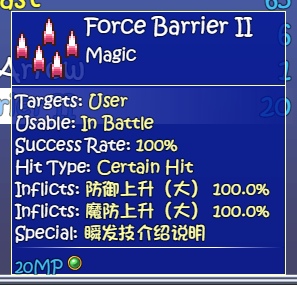
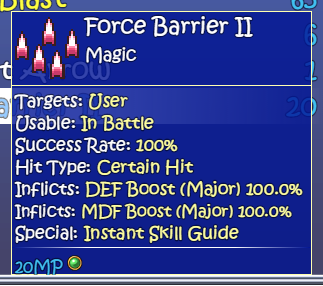
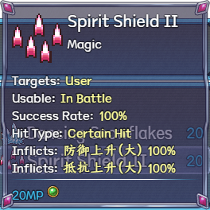
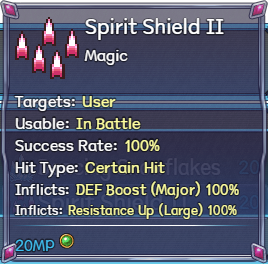

# Launcher 1.0.38 — Translate skill effect names across both databases

Fixes Chinese buff/debuff names and special-effect labels in skill details, including Force Barrier II. Full native sweeps cover 2,800 records (1,874 named skills) across Three-in-One Ver1.061 and Maple 1.7.2, with zero unexplained CJK in generated fields. Formulas, numbers, effects, costs and saves remain unchanged; Maple's different native effects are preserved. English enabled, runtime controls off.

## Three-in-One

Before:

After:

## Maple

Before:

After:

[Coverage, cause and limits](https://github.com/kitomisaitichi-design/celesphonia-launcher/blob/launcher-v1.0.38/docs/skill-fields-1.0.38-trace.md). Full-database tooltip generation and representative native UI checks are not a full gameplay replay.
