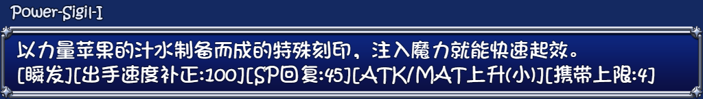
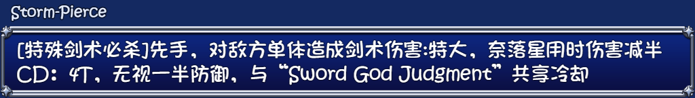
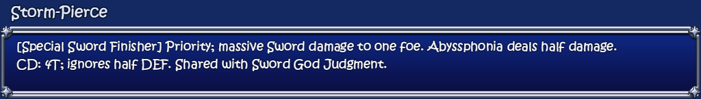

# Celesphonia Mod Library 1.0.40

## Three-in-One Ver1.07

- Adds content-hash detection and the complete 1.07 target: **5,165 creator-overlay files / 11,732 native files**. Install directly from **GoRPG 1.23 + the 1.07 creator bundle**, or combine original archives, extracted folders and individual exact files. Misleading archive extensions remain supported; intermediate versions are not required.
- Carries backed-up saves forward from all ten supported earlier Three-in-One 3.3.5 releases, including the trial. CH, Maple and 3.3.4 remain separate save families; their exact shared files can still contribute to reconstruction.
- Translates all **56 newly indexed display fields** and two derived scar-choice captions. Includes revised potions/talismans, Miasma Adaptation, Abyssphonia damage warnings, slime resistance help, the club changing point and gamepad mode labels. Existing English remains partial.
- Adds the creator's 1.07 notes and official change **208** in chronological order. Retains existing streaming, skill-tooltip, Memory Library and bedroom-display fixes. English works without runtime controls.
- Stores byte-identical embedded pack files once while retaining every logical SHA-256 check and complete public pack. This keeps the executable within older launchers' update size limit; no game files are merged or deduplicated.

### Vitality Potion I

Before:

After:

### Power Sigil I

Before:

After:

### Miasma Adaptation

Before:

After:

### Storm Pierce

Before:

After:

[Native before/after pictures, source delta and verification limits](https://github.com/kitomisaitichi-design/celesphonia-launcher/blob/launcher-v1.0.40/docs/v107-1.0.40-trace.md).

## Creator notes

— supplied November 6, 2026

1. Increased the chance of the Renegade attaching locked cursed underwear when transformation ends.
2. Strengthened Vitality Potions (formerly Life Potions), Power Potions and Power Apples. The current item database calls the revised power items **Power Sigils**.
3. Added a changing point beneath the club, limited to switching between bunny suits.
4. Adjusted succubus ears to better fit different hairstyles.
5. Clarified that Abyssphonia deals reduced damage with certain weapon/equipment skills.
6. Reduced the SP cost of some Abyssphonia skills and removed Gathering Darkness's inability to land critical hits.
7. Changed slimes from Poison immunity to high Poison resistance.
8. Military Gloves now increase restraint resistance.
9. Miasma Adaptation now also raises the Miasma tolerance cap.
10. Added a scar/mark visibility option to Ahoge Abu at home and the portable Ahoge Abu.
11. Reduced the mana recovered by nonhuman enemies when draining mana during the player's climax.
12. Increased Half-Succubus drain damage after entering Lustful Paradise.

**Synchronized with the full release — change #208**

208. Warding Talisman now activates instantly, is battle-only and costs 1 MP. First Aid Kits are menu-only. Clarity Eye Drops, Antidotes and similar remedies are now talismans.

The date above records when these notes/files were supplied locally, not an independently verified creator publication date.

