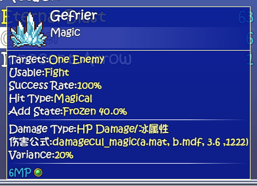
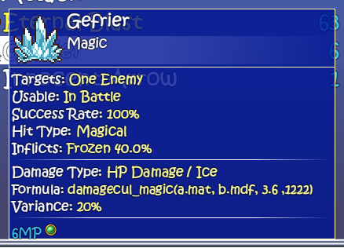
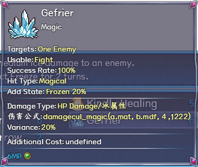
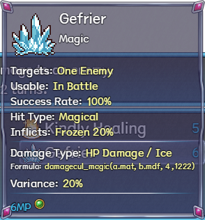

# Launcher 1.0.34 — Readable magic-skill tooltip details

Fixes mixed Chinese/English formula/element labels, Usable:Fight wording and joined label/value text in Maple and Three-in-One. Native formulas, targets, percentages, MP costs and intentional spell names remain exact. Long skill details wrap and scroll inside the viewport. Missing optional custom costs no longer print undefined; real costs and native visibility rules remain. English enabled, runtime controls off.

## Three-in-One Ver1.061

Before:

After:

## Maple 1.7.2

Before:

After:

[Native gallery](https://github.com/kitomisaitichi-design/celesphonia-launcher/blob/launcher-v1.0.34/docs/skill-tooltip-1.0.34-gallery.md) · [Source trace and limits](https://github.com/kitomisaitichi-design/celesphonia-launcher/blob/launcher-v1.0.34/docs/skill-tooltip-1.0.34-trace.md)

Verified with 85 focused native checks, the notes reader and required extracted-package apply/restore checks. This is a partial English overlay and UI verification, not a full gameplay replay. Pre-existing corrupt/unknown dense-skill metadata names are retained without guessing.
