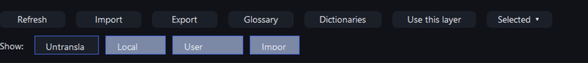

# Comparison editor repair — 1.0.44

## Report and reproduction

The user reported lag, an unhandled ContextMenuStrip disposal error while exporting/filtering, and clipped origin-filter labels. The actual native Export click path reproduced `System.ObjectDisposedException` from `ToolStripDropDown.ReparentToDropDownOwnerWindow`, `SetVisibleCore` and `OnItemClicked`. Both Export and Selected menus disposed themselves synchronously in their Closed event while WinForms was still dismissing the clicked popup. This was a lifetime bug, not a translation-data error.

The released screenshot also contained the clipped labels. Its prior bounds-only test missed clipping inside the controls. At the tested font, Untranslated had 88 pixels of measured text plus 16 pixels of padding inside a 92-pixel control; other filter labels had the same shortfall.

## Changes

- Keep two form-owned menus; do not dispose a menu during Closed. Dispose with the editor after active work finishes. Each opening snapshots its selected/filtered source rows and chosen export layer. Empty result/export states are guarded.
- Cache pack source→target maps within the immutable comparison snapshot. A refresh creates fresh maps. Do not reconstruct a 35,014-entry map for each virtual-cell draw.
- Prepare status/index data off the UI thread. Use exact source identities for virtual selection and generate the unchanged canonical persistent hash only for selected or edited entries. On refresh, removed/changed-role identities are dropped rather than applied to a new role. No run/cache storage format changed.
- Coalesce selection notifications and reuse the visible identity set. Keep row bindings/scroll position when a filter's result set stays the same. Expensive preparation is asynchronous; the remaining bounded list matching is synchronous and uses prepared lookups, avoiding stale out-of-order query results.
- Reuse the catalog and English reference decoded for local coverage. Reject/skip incompatible model runs before reading their full journals. No gameplay dictionary preparation, source controls, scopes or renderer behavior is bypassed.
- Measure button text and padding; allocate enough height and allow toolbar/filter rows to wrap. The target chooser and lower buttons respond to font size. Clear non-draft panes on empty results while retaining hidden explicit selection identities.

## Focused evidence

The diagnostic uses the same 35,014 curated source records and 3,007 real cached model entries in a private run. Production dictionaries, runs, models, game data and saves are not written by this test. Representative pre/post measurements: coverage 2,043→1,627 ms; warm comparison 768→68 ms; prepared window 1,683→1,213 ms; 60 imported-layer lookups 1,280→16 ms; five single-row selection changes averaged 5.43→0.18 ms. Phase times vary with process/filesystem warm-up; they are not broad hardware benchmarks. Filtering remains dependent on query/content length; no claim that every possible query is faster is made.

Acceptance checks use native popup mouse messages, not just direct helper calls: eight cancelled/reopened Export menus, real selected and filtered files, repeated selection-menu clearing, all 16 origin combinations, hidden selection, source-bound typed correction and empty results. Imported-file and journal changes are refreshed into a new snapshot; manual corrections retain precedence. Font-size simulations at 100%, 125% and 150% check complete label text, control containment and pane separation, with a native scaled screenshot inspected. These simulate font scaling; physical monitor/DPI switching is not claimed.

The initial scripted edit stopped on a source-indentation mismatch before the editor source was changed; its two partially changed helper files were restored from the backup and the scoped edit was reapplied. This is retained in the coordination log, not counted as a successful build/test. The original failing native menu trace remains with the baseline. Required notes/layout/extracted-release checks accompany the final package. No model retranslation, backend/device matrix or native game route was repeated for this UI-only repair. Shared JavaScript remains byte-identical to 1.0.43.

## Pictures

Use Local TL → Translations as before. Import/export/glossary contents and all source/category/target-language boundaries remain separate from curated English. Updating this launcher requires no model reinstall or cache reset.
