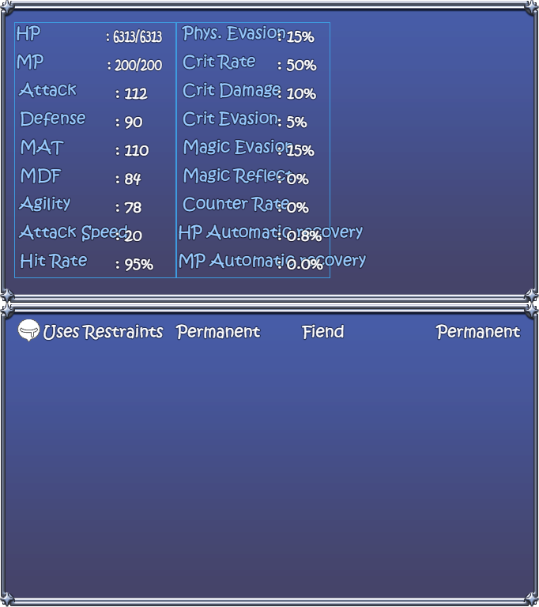
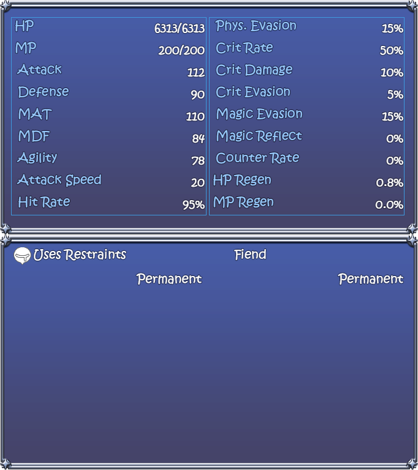
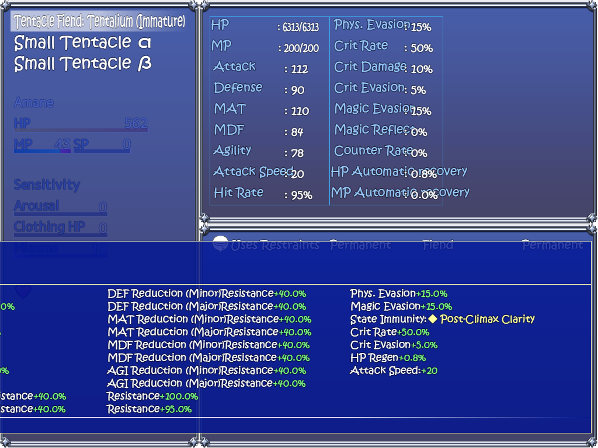
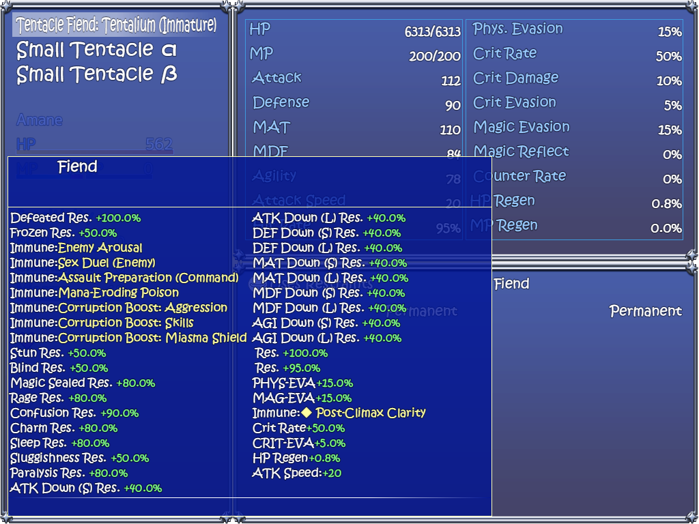

# Enemy information — native before and after

Three-in-One Ver1.061, enemy 146 in troop 40, with the normal English overlay active and runtime controls disabled. The before and after use the same native windows, prepared private state, selection and 1024 × 768 viewport. These are real engine captures; no user save is loaded.

## Stat values and state durations

Before:

After:

## Resistance and trait table

The original table is 1687 pixels wide on a 1024-pixel screen and begins at x=-663, cutting off its left side. The revised table uses readable compact labels and two columns, keeping the complete table inside the screen. Longer tables retain all rows through hover-wheel scrolling.

Before:

After:

Native PNG resolution is retained. Background game sprites are hidden consistently in these presentation captures, so the information windows can be compared directly. The native mechanics and original data are unchanged. Maple has a different plugin implementation without this state inspector; its existing equipment tooltip was compared separately against its own baseline.

[Source trace and verification limits](enemy-info-1.0.33-trace.md)
