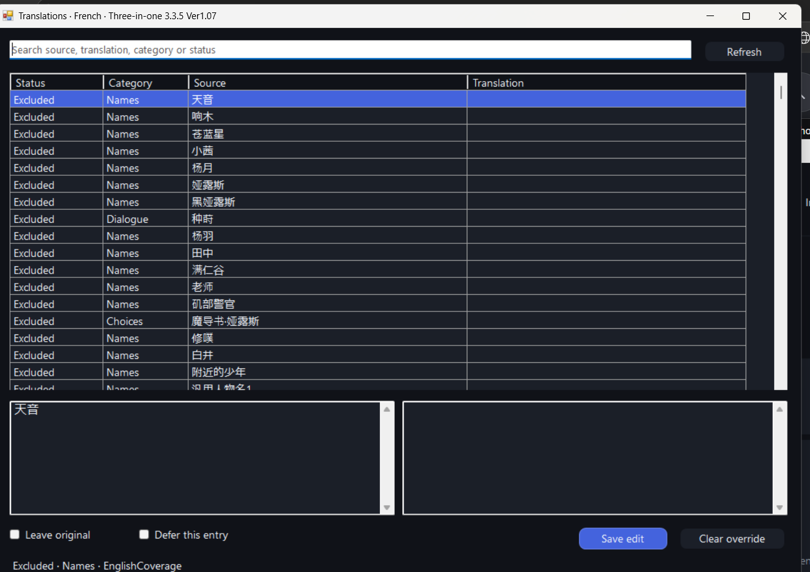
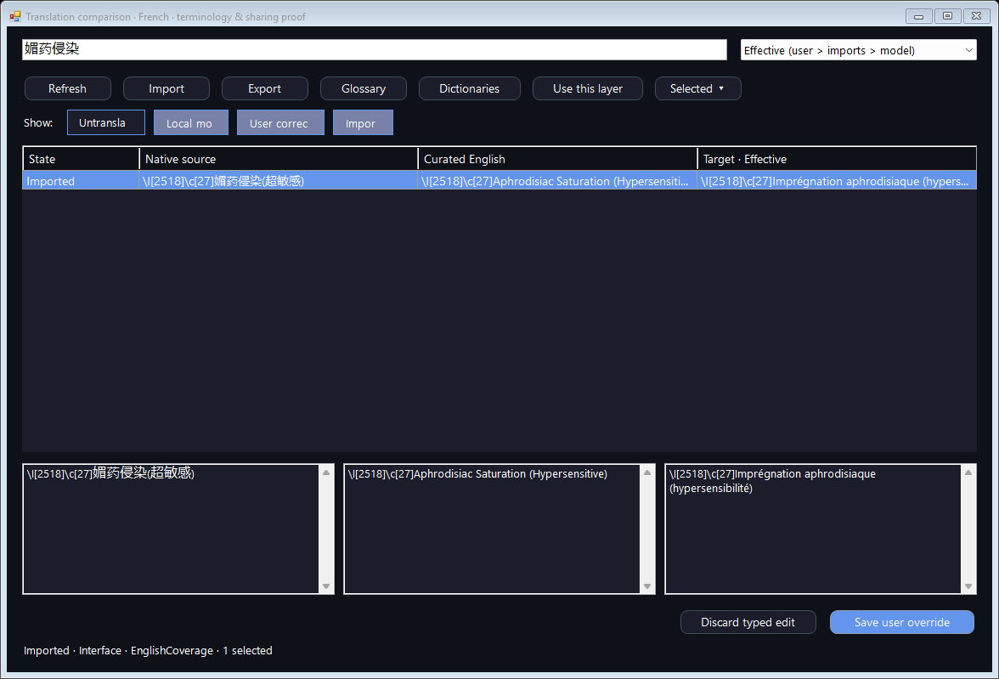

# Local dictionary sharing — launcher 1.0.43

The launcher is a compiled Windows C#/.NET WinForms application. Its in-game display adapter is JavaScript for RPG Maker/NW.js. PLaMo runs through an owned local llama.cpp process; this is not a hosted web translation app. The model supplies dictionary content to the existing Celesphonia display pipeline. Native formulas, switch/variable names, conditions, quests and engine arguments remain native.

## Workflow

1. In Local TL select an installed game and run, then open Translations.
2. Select any combination of Untranslated, Local model, User corrected and Imported. Selected origins are OR-ed, then intersected with search. A source containing both model text and a user correction matches either. Disabled imports remain inspectable. No checked origins shows no rows. Filters do not change rendering or delete content.
3. Choose the target view to compare effective/model/import/user text with the current English reference. Use this layer changes the rendered layer explicitly. Effective priority is user > selected imports > model > original. Selected dictionaries are applied in saved order; importing a newly enabled pack puts it last. The Dictionaries window saves its checked list in displayed order, so conflicting imports follow that order. Authored overrides always win in Effective.
4. Ctrl/Shift selects rows. Selection persists across filtering, including hidden rows; the status gives that count. Clear selection clears all selected identities. A typed edit is saved only to the source shown in its source pane. Bulk actions never copy one typed target over unrelated sources.
5. Glossary edits native PLaMo glossary/context inputs. Fantasy RPG and Adult fantasy RPG are general context starters. Celesphonia français is a small terminology starter set. Use the optional current curated-English meaning reference. Save changes for new requests; Refresh affected model text optionally regenerates relevant cached entries. User/imported targets are retained. A selected/affected refresh finishes by pausing; it does not start unrelated pending translation work. Resume pending continues that separately. Old journal results remain until replacements finish, and the append-only history remains on disk.
6. Export selected or all filtered entries from the viewed layer. Optionally include the glossary/context profile. Other users select a matching game-family/language run and Import; metadata-free JSON is visibly bound to that selected run. No installed model is required to use imported/cached text.

## Format and boundaries

Native JSON has Kind=`Celesphonia.Dictionary`, Format=1, Id, Name, Family, OriginVersion, Language and Entries. Each entry carries Source, Target, Role, SourceHash, ReferenceHash and provenance; Glossary is optional. No install root, run ID, saves, model bytes, executable JavaScript or derived adapter Fields is exported. Only dictionary content is read from imports. Existing source→target/MTool JSON and prior local Source/Target JSONL are also detected. A ZIP must contain one dictionary-pack.json or dictionary.json; paths, entry count and compressed/expanded size are bounded (48 MiB and at most 1,024 entries). Nothing is extracted or executed from the archive.

Family/language mismatch is rejected. Icon/control slots, numbers and line layout are checked; conflicting duplicate sources are rejected. Invalid entries are counted in preview. Unchanged source-only templates are skipped. Preview shows differing targets; enabling a pack is explicit and user corrections retain priority. Replacing a pack keeps a backup. Imported profiles are optional. Custom context is included only when the exporter chooses to include that profile.

Reusable content lives under `%LOCALAPPDATA%/Celesphonia/LocalTranslation/Library`, separately from root-bound Runs and Bindings. New compatible runs retain matching authored edits and selected dictionaries, profile and backend settings. Exact existing model results can be reused within family/language and pinned model identity; ambiguous older model targets are not guessed. Source-role changes prevent applying an old target. Changed native source is never fuzzy-matched. Entries outside current English coverage remain inactive and retained. A future English coverage update can activate an unchanged compatible imported source; runtime aliases/fields are regenerated by current EnglishSupport preparation. The English comparison refreshes from current curated content. Existing generated entries whose English reference changed are marked, with optional refresh; authored/imported work is not overwritten automatically.

Changing game layers still follows the existing next-launch boundary between curated English and Local TL. Cache edits and dictionary/layer payload refreshes are live while local mode is active. User data, models, successful journals and saves are preserved during installation. There is no automatic import into curated English and no automatic enrollment of arbitrary live strings.

## Evidence and limits

- 31 focused glossary/library/editor checks: selected-only roundtrip, source maps, JSONL and ZIP detection, inactive→covered reuse, different root, changed role/source, mismatched family/language, invalid slots, duplicates/truncation, precedence, minimum-size layout, selection across filtering, unsaved edit binding and unchanged successful journal bytes.
- All 16 origin-filter combinations, combined search, empty-edit rejection and unchanged rendering options were checked in the native editor.
- The actual installed 0.8B and 2B GGUF templates support glossary/context. One reported label was translated with each model on the existing Vulkan device. Both returned aphrodisiaque and preserved the icon/color slots. The original 0.8B cached result used sérocuteur. This establishes the specific term correction only.
- Native Three-in-One 1.07 and Maple 1.7.2 fixtures used their own covered-source sets and current shared adapters. Imported targets and authored corrections rendered; raw color parsing, command names/symbols and native data remained unchanged. Fixtures advanced their own splash and used no user save writes.
- Live provider checks cover BOM-prefixed journals, user precedence, explicit model layer refresh and a new generated result replacing an earlier published snapshot.
- The existing English regression suite passed stored-data immutability and all five dictionaries. Required notes/layout/extracted-release checks accompany the published artifact.

Two initial native fixture waits failed. A diagnostic found a BOM in the private .NET-written journal and a splash awaiting input; the reader now accepts the BOM and only the disposable fixture advances splash. The failures were retained in PLAN.md rather than counted as passes. The first filter probe sampled before asynchronous loading finished; its corrected probe waits for the loaded state. No full-gameplay, every-language quality, all-device/DPI or unknown future-mod compatibility claim is made.

## Pictures and reference

Native glossary/context options: https://huggingface.co/pfnet/plamo-3-translate-0.8b-GGUF#translation-options
