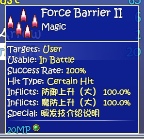
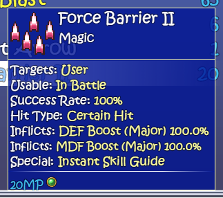
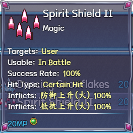
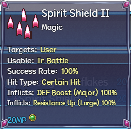

# Skill effect-name coverage — launcher 1.0.38

## Correcting the earlier coverage claim

1.0.34 checked IDs 64/65/54/1/15/47 per variant, with 43 Three-in-One and 42 Maple assertions. It localized captions, elements and layout, but explicitly exempted dense skill 47's unresolved name text. Six sampled skills did not establish broad field coverage. Force Barrier II (92) was outside that sample.

## Cause and correction

The native formatter concatenated a state name with its chance before passing the entire row to translation. A dictionary entry for the name alone could not match that row. Common-event fields also exposed untranslated internal labels. The shared skill adapter now scopes name translation to native name/effect builders before color formatting and row construction, and handles passive state titles as display copies. Native calculations, database names, plugin parameters, IDs, note tags, common-event code and formula builders are untouched. Scoped formatter replacements are restored in finally blocks, including nested calls. Non-skill tooltips delegate unchanged.

Reviewed special labels are display-only. Event 1093 explicitly explains the native instant action rule; its caption is Instant Skill Guide. Existing reviewed translations resolve state names such as 1-Time Boost and Assault Preparation (Late Reaction). We did not infer an AGI modifier from the ambiguous raw label. Every original numeric field remains in the rendered output. Intentional German-style spell names remain unchanged.

## Native before and after

### Three-in-One Ver1.061

Before:

After:

### Maple 1.7.2

Before:

After:

Maple's Force Barrier II applies its native Resistance Up effect; Three-in-One applies MDF Boost. Neither is rewritten to match the other variant.

## Coverage and preservation

Tests/NativeSkillFieldCoverageFixture.js enumerates every non-null skill through the native tooltip generator with English active and runtime controls absent. Three-in-One: 1,300 records/965 named. Maple: 1,500 records/909 named. Remaining records are blank/reserved and are still enumerated. The sweep includes base, damage, cost, requirement, top/bottom and nested passive-state data/title/condition/after arrays. All generated fields have zero unexplained CJK residuals after correction, versus 534/494 residual rows before. All 2,800 numeric-field sequences and damage/formula row arrays match the baseline exactly. No native formatter exceptions occur.

Eight representative skills per variant include the earlier six plus Force Barrier/Force Barrier II. Native snapshots check empty/reopened selection, non-skill parity, English effect names, a 320x300 viewport, hover scrolling, exact database/effect/formula/state preservation and source hashes. Captures are actual native bitmaps, re-encoded losslessly with pixel hashes. Whole-database field generation is broader than the eight visual samples; it is not a full game or battle-action replay.

Two early baseline runs failed because native rpg_objects.js skillMpCost initializes mpCostPer on unopened skills. The fixture was re-planned to run that native initialization before freezing the database; exact equality and source-file checks remain. An early numeric check caught One-Time Boost replacing the literal numeral 1; this field now shows 1-Time Boost. A variant-specific assertion was corrected after confirming Maple's distinct native effect. No native effects or errors were suppressed to pass these checks.

## Release packaging

The notes reader accepts both old plain and new gzip embedded text. The build verifies a byte-exact decompression round trip for README/changelog resources; compression creates room for offline before/after crops without raising the legacy EXE size limit or adding dependencies. All 45 notes images and the original three note views are checked. The portable ZIP retains the historical 44-file layout, with no private profiles or saves. Runtime/dictionary consistency and extracted update/apply/restore gates are checked for both variants. Existing enabled English overlays refresh on normal launch without cheats.
