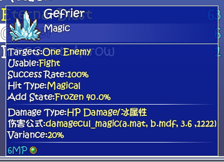
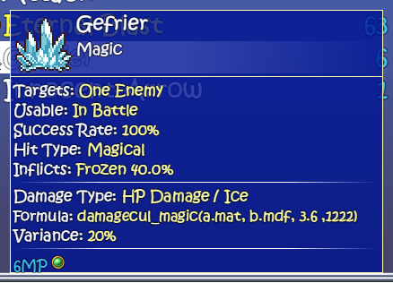
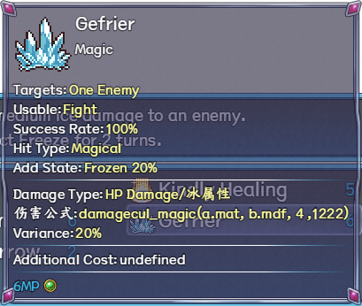
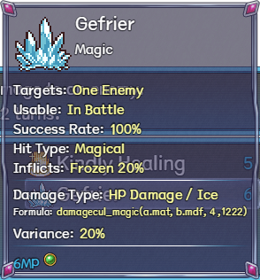

# Magic-skill details — native before and after

English is enabled and runtime controls are disabled in these private native-engine captures. Each pair uses the same skill, native actor preparation, selection and viewport in its own variant. No personal save is loaded or written. Panel width changes because the translated text is measured before layout.

## Three-in-One Ver1.061 — Gefrier, skill 64

Before: mixed Chinese/English formula and element text, joined labels and `Usable:Fight`.

After: English lower details and natural wording. Native `damagecul_magic(a.mat, b.mdf, 3.6 ,1222)`, 40.0% Frozen and 6 MP remain.

## Maple 1.7.2 — Gefrier, skill 64

Before: the same label/element problem and a native missing optional field shown as `Additional Cost:undefined`.

After: English labels and no absent-field caption. Maple's own formula multiplier 4, 20% Frozen and 6 MP remain; this patch does not copy Three-in-One's balance values.

The offline notes embed only a focused native formula-caption crop to remain within existing updater limits. These full panel PNGs preserve native pixels and font size; PNG encoding is lossless. See the [source trace](skill-tooltip-1.0.34-trace.md) for tests and limits.
