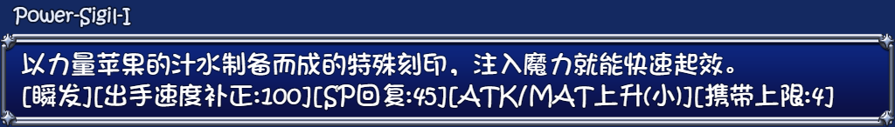
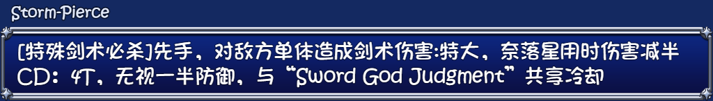
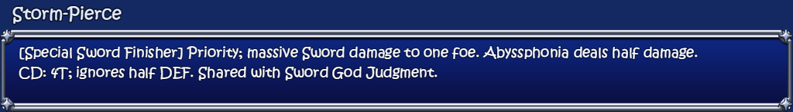

# Ver1.07 support — launcher 1.0.40

The supplied single-volume RAR5 archive is 548,495,499 bytes, SHA-256 `f14e704c5f4badb0ec95bdcc510f2ff31627ee3d0437f0dab9fe97df3ee7a8e8`. Detection uses its content, including the misleading extension. The 5,165 supplied overlay files merge with the verified GoRPG base into an 11,732-file fresh target. Seven prior ear/tail PNGs and the #207 log are absent from this bundle; a gamepad-mode plugin and #208 log are added. No obsolete previous-overlay entries are demanded for a fresh install.

All ten earlier registered Three-in-One 3.3.5 versions, including the trial, pass forward route and save-family checks. The 36 existing historical routes remain checked. CH, Maple, 3.3.4 and unknown versions retain separate save boundaries. Exact shared originals from any source can contribute to reconstruction without implying save compatibility.

The actual new game was installed from GoRPG plus the original 1.07 RAR, with all target hashes verified and 16 source saves copied byte-for-byte after backup. Full-target planning also passed using a partial renamed ZIP, recursively nested files and renamed individual originals alongside shared bases. Missing originals still stop installation. Uninstall preview recognizes the new native reference. This is one full direct installation and complete mixed-source hash planning, not ten separate installed games or a full mixed-source replay.

The fixed inventory finds 56 new indexed display fields. All were reviewed/translated, with two additional guard-stripped scar-choice aliases. Source fields/blocks and their individual lines are distinct inventory units. The inherited translation remains partial: the new pack contains 35,014 translated entries out of 56,097 catalog entries. Native event lists, effects, IDs, conditions, formulas and saves are not translated or replaced. See `English/v107-reviewed-overrides.json` and `Tests/V107TranslationReview.json` for exact changed keys and contexts.

Native English-on checks pass without runtime controls: 56 changed fields have no CJK residue, both real scar-choice guard branches keep their behavior, Miasma-cap and half-damage warnings render, and the existing bedroom and Memory Library display adapters remain present. The fixture initializes native caches before freezing the database, loads no user save and performs no gameplay route or item purchase. Before/after pictures below use the same 1.07 native help windows with the prior versus updated display dictionaries; the prior dictionary is deliberately supplied by the private fixture to reproduce missing new keys.

The creator's native mechanics are retained exactly. The chronological developer notes reproduce the supplied announcement, including #208; that announcement is not a claim that every mechanic was gameplay-tested. The source item data still contains its own stored occasion values, which the launcher does not rewrite.

Byte-identical embedded English files share a strictly validated byte array. Every logical entry still has its own manifest/hash check; aliases cannot chain or override real entries. Older plain snapshots remain accepted. Public packs retain their full three-file form and all historical dictionary/catalog bytes remain unchanged. The public updater archive remains an ordinary ZIP within the existing limits.

## Native display comparison

### Vitality Potion I

Before:

After:

### Power Sigil I

Before:

After:

### Miasma Adaptation

Before:

After:

### Storm Pierce

Before:

After:

